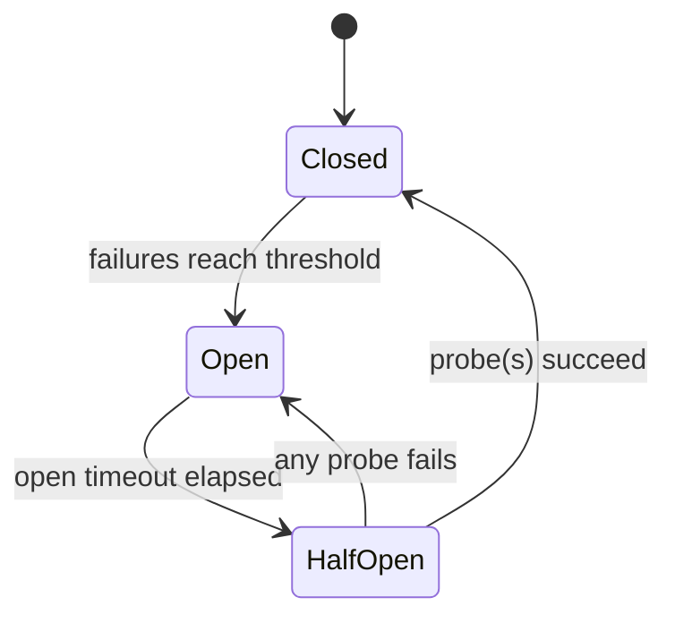

# Circuit Breaker: Theory and Interview Follow-ups

[Back to LLD topics](../LLD-Topics.md)

**Target:** 3-4 YOE Go developer. Goal: explain and design it on a whiteboard and survive the follow-ups. This is theory only.

---

## 1. The Problem

Service A calls service B. B becomes slow or dead.

Without protection:

1. A's goroutines pile up waiting on B (each holds memory, a connection, maybe a DB slot).
2. A runs out of resources and becomes slow or dead too.
3. Everything that calls A fails as well. This is a **cascading failure**.
4. Callers retry, which loads B even more and stops it from recovering. This is a **retry storm**.

A circuit breaker **fails fast** when B is known to be unhealthy:

- It protects the **caller**: no resource exhaustion, and fast errors instead of slow ones.
- It protects the **callee**: it gets breathing room to recover.

Analogy: a house fuse. Too much current trips it. You fix the problem, then reset it.

---

## 2. The State Machine (memorize this)



| State | Calls allowed? | What happens |
|---|---|---|
| **Closed** | All | Normal operation. Failures are counted. Enough failures trip it to Open. |
| **Open** | None | Calls fail immediately; the dependency is **not called**. After a timeout it moves to Half-Open. |
| **Half-Open** | A few "probe" calls | Tests whether the dependency recovered. Success closes it. Any failure sends it back to Open and restarts the timeout. |

"Closed" means the circuit is closed, so current flows and requests pass. It sounds backwards, and interviewers like to check it.

---

## 3. Requirements to Clarify First

Say these out loud at the start.

**Functional**

- Wrap any call to a dependency.
- Count failures and trip automatically.
- Fail fast while open.
- Recover automatically via half-open probing.

**Non-functional**

- Thread-safe (many goroutines call concurrently).
- Tiny overhead on the hot path.
- Configurable and testable.
- Observable (state-change hook for metrics and logs).

**Questions to ask the interviewer**

| Question | Why it matters |
|---|---|
| One breaker per what: service, endpoint, host? | Per-host stops one bad pod from blocking all pods. Per-service is simpler. |
| What counts as a failure: errors only, or timeouts and 5xx too? | A 404 or a user cancellation does not mean the dependency is sick. |
| Consecutive failures or failure rate? | Different algorithms (section 5). |
| Is a fallback needed? | Affects the API and the user experience. |
| One process or shared across replicas? | Shared state is a different problem (section 8). |

---

## 4. Design Decisions

### Components

| Component | Responsibility |
|---|---|
| Config | Failure threshold, open timeout, number of probes, what counts as a failure |
| State | Current state, failure counters, time it opened, probes in flight |
| Admission check (before the call) | Allow or reject the call based on state |
| Result recording (after the call) | Update counters, possibly change state |
| Listener | Notified on state changes (metrics, logs) |

### Flow of one call

```text
caller -> admission check -> (rejected: fail fast)
                          -> (allowed) run the real call -> record result -> maybe change state
```

### Key decisions and the reason for each

1. **Never hold the lock while the real call runs.** The call can take seconds. Holding a mutex across it would serialize every caller. Use two short critical sections instead: one for admission, one for recording.
2. **Lazy Open to Half-Open.** No timer goroutine. On each incoming call, check whether `now - openedAt >= timeout`. Nothing needs to happen until a call arrives, so a timer adds a lifecycle (start, stop, leak risk) for no benefit. It is also easier to test.
3. **Injectable clock.** Tests move time forward instead of sleeping.
4. **Generation counter.** Prevents stale results from corrupting state (section 6.2).
5. **Pluggable failure definition.** A strategy that decides whether an error counts.
6. **Run listeners outside the lock.** A slow or re-entrant callback must not block or deadlock the breaker.

### Design patterns in the design

| Pattern | Where |
|---|---|
| Functional options | Configuration, see [08-Functional-Options](../DESIGN-PATTERNS/08-Functional-Options.md) |
| State | The three states, see [07-State](../DESIGN-PATTERNS/07-State.md) |
| Strategy | The "what counts as a failure" function, and the failure-detection algorithm |
| Observer | State-change listeners |
| Decorator | Wrapping an HTTP client or gRPC interceptor with the breaker |

---

## 5. Failure Detection Strategies (very common follow-up)

| Strategy | How it works | Pros | Cons |
|---|---|---|---|
| **Consecutive failures** | N failures in a row trip it; any success resets the counter | Trivial, O(1) memory | A service failing 50% of the time may never trip |
| **Failure rate, count-based window** | Look at the last N calls; trip if failure % >= X and calls >= minimum volume | Handles flaky services | Needs a ring buffer; can be stale on low traffic |
| **Failure rate, time-based window** | Look at the last T seconds, split into buckets (e.g. 10 x 1s); old buckets expire | Reflects recent reality | More complex bucket handling |
| **Slow-call rate** | Calls slower than a threshold count as failures | Catches "slow but not failing" | Needs timing, and a threshold per dependency |

**Minimum request volume:** with 1 request and 1 failure the rate is 100%. Tripping on that is wrong, so rate-based breakers need a minimum number of calls first.

**Ring buffer idea (count-based window):** keep the last N outcomes in a fixed array. When a new outcome overwrites the oldest, subtract the old one from the failure count and add the new one. Updates and the trip check are both O(1). Reset the window on every state change.

---

## 6. Concurrency: What Interviewers Dig Into

### 6.1 State can change while a call is running

The real call runs outside the lock. By the time it finishes, the breaker may be in a different state than when the call started. This leads to the next problem.

### 6.2 The stale-result problem and the generation counter

Scenario:

1. Breaker is Closed. Call X starts and is slow (5 s).
2. Meanwhile other calls fail and the breaker trips to Open.
3. The timeout passes, a probe succeeds, and the breaker is Closed again (a new healthy period).
4. Call X finally returns with a failure from the **old** period.

If X's failure is counted, it unfairly counts against the new healthy period.

**Fix:** keep a `generation` number that increases on every state change. Each admitted call remembers the generation it started in. When the result arrives, compare it with the current generation and **ignore the result if they differ**.

### 6.3 Half-open probe limit and the thundering herd

When the open timeout elapses, 1000 goroutines may arrive at once. If all were allowed through, the recovering service would be flooded again.

**Fix:** under the lock, count probes in flight. Admit at most N. Reject the rest immediately.

### 6.4 Which synchronization primitive?

| Option | Verdict |
|---|---|
| `sync.Mutex` | **Best default.** The critical sections are a few integer updates (nanoseconds). Simple and correct. |
| `sync.RWMutex` | No gain. Almost every call writes counters. |
| `atomic` | Possible for closed-state counters, but a state transition touches several fields together, so you still need a lock or one packed word with CAS. Premature complexity. |

Honest answer: "Mutex first. Measure before optimizing. The lock is held for nanoseconds, and the real call runs outside it."

### 6.5 A stuck probe

If an admitted half-open probe never reports back (for example it panics and nothing records the result), the in-flight count never goes down and the breaker can never recover. Two defenses:

- Always record a result, even on panic (use `defer` + `recover`, then re-panic so the panic is not hidden).
- Put a timeout or context deadline on the call, so it cannot hang forever.

---

## 7. Practical Usage

### What should count as a failure?

- **Count:** timeouts, connection errors, 5xx.
- **Do not count:** 4xx, validation errors, cancellation by the caller.

The caller giving up says nothing about the dependency's health. Timeouts *you* impose on the dependency do count.

### Fallback when Open

- Cached or stale data.
- A default value.
- A degraded feature.
- Queue the work for later.
- A clear, fast error (for example HTTP 503 with `Retry-After`).

Use a **sentinel error** such as `ErrOpen` and check with `errors.Is`, so callers can tell "the breaker rejected me" from "the call failed".

### Where to apply it

- HTTP client round-tripper (decorator).
- gRPC client interceptor.
- A wrapper around DB or cache clients.
- One breaker per downstream, kept in a registry keyed by name.

### Observability

Emit a metric or log on every state change, and alert on Open. Also track rejected-call counts.

---

## 8. Distributed Circuit Breakers

A breaker kept in memory is **per process**. With 50 replicas, each replica learns on its own that B is down.

| Approach | Notes |
|---|---|
| **Per-instance (default)** | No coordination and no extra failure mode. Each replica sends a few failing calls before tripping. Hystrix, Resilience4j and gobreaker do this. Usually good enough. |
| **Shared state in Redis** | Consistent view, but every call now depends on Redis. You need a fallback if Redis is down (usually fall back to local state). |
| **Service mesh** (Envoy / Istio outlier detection) | Moves the logic out of app code, per upstream host. Common in production. |

Say: "Start per-instance. Shared state adds a dependency to protect against a dependency."

---

## 9. Circuit Breaker with Messaging (Kafka, RabbitMQ, SQS)

### Why it differs from gRPC

- With gRPC the caller waits for the answer, so a failure hits a user right now. The breaker fails fast.
- With messaging, a broker sits between producer and consumer. Messages **wait in the queue**, so a slow consumer does not directly block a user.

The problem is on the **consumer side**. A consumer reads an event (e.g. `OrderPlaced`) and calls a dependency (Payment, a third-party API, a DB) to process it. If that dependency is down:

- Every message fails and gets retried again and again.
- The consumer keeps hammering the dead dependency, and its workers get stuck on timeouts.
- Messages churn through redelivery or flood the dead-letter queue (DLQ) for no reason.

**The breaker does not wrap the message. It wraps the downstream call the handler makes.**

```text
Broker --> Consumer --> [Circuit Breaker] --> Payment API / DB / 3rd party
```

### Flow

| State | What the consumer does |
|---|---|
| **Closed** | Consume, call the dependency through the breaker, acknowledge on success. |
| **Open** | Stop burning messages. Do one of: **pause consumption** (Kafka: pause partitions; RabbitMQ: stop consuming or lower prefetch), **don't acknowledge** so the message is redelivered later (delayed NACK, or let the visibility timeout expire), or **send to a delay/retry queue**. The messages stay safe in the broker. |
| **Half-Open** | Resume and let **one message** through as a probe. Success closes the breaker and normal consumption resumes. Failure reopens it and consumption stays paused. |

### What changes compared to gRPC

| | gRPC / HTTP | Messaging consumer |
|---|---|---|
| When Open, you... | Return an error or a fallback to the caller | **Stop consuming** or delay the message |
| Where failed work waits | Nowhere; the caller gets an error | **In the broker**, so nothing is lost |
| Main goal | Protect the caller from hanging | Stop wasting messages, retries and DLQ space on a dead dependency |
| Main danger | Cascading failure | Retry storm, DLQ flooding, confusing poison messages with outages |

The key idea: **the broker is the buffer.** Open does not mean "reject"; it means "pause and keep the messages for later."

### Mistakes to avoid

1. **Do not send messages to the DLQ just because the breaker is open.** The messages are fine; the dependency is down. A DLQ is for **poison messages** (bad payloads that will never succeed).
2. **Do not count bad messages as dependency failures.** A malformed message is the message's fault. Only dependency errors (timeouts, 5xx, connection errors) should trip the breaker.
3. **Redelivery can duplicate work.** Handlers must be **idempotent**.
4. **Ordering trade-off.** Pausing a partition keeps order. Moving messages to a retry queue can break it.

### Producer side

Publishing is also an outbound call. If the **broker** is down, a breaker around the publish call makes sense. When Open, write the event to a local **outbox table** and publish it later (the outbox pattern).

---

## 10. Interview Q&A (the follow-ups)

**Q: Circuit breaker vs retry vs timeout vs bulkhead vs rate limiter?**

| Mechanism | Protects | Question it answers |
|---|---|---|
| Timeout | Caller | "How long do I wait for one call?" |
| Retry | Request success | "Should I try again?" (can make outages worse) |
| **Circuit breaker** | Caller **and** callee | "Is the dependency healthy enough to bother calling?" |
| Bulkhead | Caller | "How many concurrent calls may this dependency use?" (isolation) |
| Rate limiter | Callee | "How many calls per second am I allowed?" See [Rate_Limiter](../Rate_Limiter/01-Rate-Limiter.md) |

Typical order, outer to inner: retry, then circuit breaker, then timeout, then the call. Retries should go **through** the breaker so an open breaker stops the retry storm. Retry only errors that are safe to retry, with backoff and jitter.

**Q: The breaker is Open and the dependency recovers. How do we find out?**
We do not poll. After the open timeout, the next real request becomes the probe (lazy transition). No background goroutine.

**Q: How do you choose the open timeout?**
Roughly the dependency's typical recovery time (seconds to a minute). Too short means you keep hitting a dead service. Too long means you stay unavailable after it recovered. Improvement: **exponential backoff** on repeated half-open failures (30s, 60s, 120s, capped), with jitter.

**Q: Why not a timer goroutine to flip to Half-Open?**
It needs a lifecycle (start, stop, leak risk), has to be synchronized with state, and adds nothing: nothing needs to happen until a call arrives. Lazy evaluation is simpler and deterministic to test.

**Q: State pattern (a type per state) or an enum plus `switch`?**
With three states and small logic, an enum plus `switch` is enough. The State pattern (each state implementing its own `allow` and `record`) pays off when states have a lot of behavior or more states are added (e.g. forced-open, disabled). Say you would refactor if it grew.

**Q: A call was admitted while Closed but finishes after the breaker is Open. What happens?**
Its result is ignored through the generation check (section 6.2).

**Q: Can the breaker get stuck in Half-Open?**
Only if an admitted probe never reports back. Defend with panic-safe result recording and a timeout on the call (section 6.5).

**Q: Why not count context cancellation as a failure?**
The caller gave up. That says nothing about the dependency's health.

**Q: How do you avoid every replica probing at the same instant?**
Add random jitter to the open timeout, and allow only one probe per replica.

**Q: Does a circuit breaker make sense for event consumers?**
Yes, but around the downstream call the handler makes, not around the message. When Open, pause consumption or delay redelivery instead of failing messages, because the broker is the buffer and nothing is lost. Do not send messages to the DLQ for an outage, and do not count poison messages as dependency failures. Handlers must be idempotent because of redelivery (section 9).

**Q: How would you add context support?**
Pass the context into the wrapped call. Check `ctx.Err()` before admission, so a dead context does not use up a half-open probe slot.

**Q: How do you test it?**
- Use an injectable clock to move time forward, with no sleeping.
- Table-driven tests for each transition (trip, reset on success, half-open success, half-open failure).
- Use channels to force interleavings (block the first probe, fire a second call, assert it is rejected).
- Run concurrent tests with `go test -race`.

**Q: Limitations of a basic breaker?** (being upfront earns trust)

- Consecutive-failure policy misses flaky services (use a failure rate).
- Per-process state.
- No slow-call detection, no built-in timeout, no backoff on the open duration.
- The state is only re-evaluated when a call arrives, so a status read can still say "open" after the timeout has passed.

---

## 11. Whiteboard Script (2 minutes)

> "A circuit breaker wraps calls to a dependency and has three states. **Closed**: calls pass and I count failures. When failures reach a threshold it goes **Open**: calls fail immediately without touching the dependency. After a timeout, the next call moves it to **Half-Open**, where I allow a limited number of probes. If a probe succeeds it closes; if it fails it re-opens and the timeout restarts.
>
> In Go, I'd guard state with a mutex but never hold it while running the user's call, so I split admission and result recording into two short critical sections. A generation counter makes sure a slow call from a previous state can't corrupt the current one. The open-to-half-open move is lazy, evaluated on the next call, so there's no timer goroutine. What counts as a failure is pluggable, time is injectable for tests, and a state-change callback gives observability. It's per-process; I'd use a mesh or shared state only if needed."

---

## 12. Checklist

- [ ] Can I draw the state diagram and name the transition conditions?
- [ ] Can I explain why the call runs outside the lock?
- [ ] Can I explain the generation counter with the slow-call scenario?
- [ ] Can I explain half-open probe limiting and the thundering herd?
- [ ] Can I compare consecutive vs rate-based detection?
- [ ] Can I place it relative to retry, timeout, bulkhead and rate limiter?
- [ ] Can I explain how it applies to message consumers (pause, don't DLQ, idempotency)?
- [ ] Can I state what a basic implementation does **not** do?

## References

- [sony/gobreaker](https://github.com/sony/gobreaker): the reference Go implementation.
- [Martin Fowler: CircuitBreaker](https://martinfowler.com/bliki/CircuitBreaker.html)
- [Microsoft Azure: Circuit Breaker pattern](https://learn.microsoft.com/azure/architecture/patterns/circuit-breaker)
