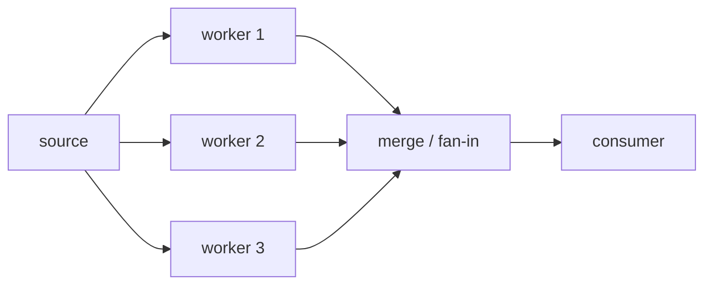

# Fan-In Multiplexer

> **Merge N input channels into one output channel, close the output exactly once when all inputs are done (or the caller cancels), and never leak a goroutine.**

Code: [fanin.go](fanin.go), tests: [fanin_test.go](fanin_test.go). Compiled, vetted, and run with `go test -race -count=5` (Go 1.26). Benchmarks are from one laptop; compare the ratios, not the absolute numbers.

Related: [Pipeline](../DESIGN-PATTERNS/09-Pipeline.md), [Worker Pool](../DESIGN-PATTERNS/10-Worker-Pool.md), [Bounded Parallel Processor](../Bounded_Concurrency/01-Bounded-Parallel-Processor.md).

Sources used: the Go blog *Pipelines and cancellation* (canonical `merge`, `done` channel, "who closes"), the Go blog *Context*, the Go wiki *CodeReviewConcurrency*, and the golanginterview.com patterns list (fan-out/fan-in vs worker pool, pipeline best practices).

---

## 1. Vocabulary (say this precisely in an interview)

| Term | Meaning |
|---|---|
| Fan-out | Many goroutines read from the **same** channel to share work |
| Fan-in | One reader consumes **many** channels merged into one |
| Multiplexer | Another name for fan-in (N to 1). A **demultiplexer** is the reverse (1 to N by key) |
| Dynamic multiplexer | Inputs can be added while running (`Mux.Add`) |

Fan-out then fan-in is the standard "parallelize a stage" shape:



---

## 2. The Core Implementation

```go
func Merge[T any](ctx context.Context, ins ...<-chan T) <-chan T {
	out := make(chan T)
	var wg sync.WaitGroup
	for _, in := range ins {
		if in == nil { // ranging over a nil channel blocks forever
			continue
		}
		wg.Add(1)
		go func() {
			defer wg.Done()
			for v := range in {
				select {
				case out <- v:
				case <-ctx.Done():
					return
				}
			}
		}()
	}
	go func() {
		wg.Wait()
		close(out)
	}()
	return out
}
```

Why each piece exists:

| Piece | Reason |
|---|---|
| One goroutine per input | A single goroutine blocked on input A cannot serve input B |
| `wg` + closer goroutine | Only after **all** senders are done may `out` be closed. Closing from a forwarder panics the others (`send on closed channel`) |
| `wg.Add` before `go`, and before the closer starts | If `Add` races with `Wait` at counter zero, `out` can close early |
| `select` with `ctx.Done()` on every send | If the consumer stops reading, a bare `out <- v` blocks forever: a goroutine leak |
| Nil-channel skip | `range` over nil never ends, so `wg.Wait()` never returns and `out` never closes |
| Receive-only `<-chan T` return type | The caller cannot close or send on `out`. The merger **owns** it |
| Go 1.22+ loop variable | `in` and `i` are per-iteration, so no `in := in` copy is needed. Before 1.22 this was the classic bug |

Rule to state out loud: **the party that does the sending (or coordinates all senders) closes. Receivers never close.**

---

## 3. Variants (know when to pick each)

| Variant | How | Pros | Cons |
|---|---|---|---|
| `Merge` (goroutine per input) | Section 2 | Simple, fast, any N | N goroutines, one extra hop |
| `Merge2` (select, nil trick) | One goroutine; `select` over `a`, `b`; set a closed input to `nil` | Zero extra goroutines | Fixed arity; `select` cases are static |
| `MergeReflect` | `reflect.Select` over a `[]reflect.SelectCase` | Any N, one goroutine | Slower, allocates, loses compile-time typing (`Interface().(T)`) |
| `MergeTagged` | Wrap each value as `Tagged{Src, Val}` | Consumer knows the source | Extra allocation per item |
| `MergeOrdered` | Min-heap of each input's head element | Globally sorted output | Needs sorted inputs; blocks until **every** open input has a head |
| `Mux` | `Add` under a mutex, `Seal` when done | Dynamic inputs | Must define "when does `out` close" (explicit `Seal`) |

The nil-channel trick (`a = nil` after close) is the single most-asked `select` idiom: a nil channel is never ready, so `select` skips it.

Measured on this machine (`go test -bench . -benchmem`, two endless producers):

| Impl | ns/op | allocs/op |
|---|---|---|
| `Merge` | 920 | 0 |
| `Merge2` | 980 | 0 |
| `MergeReflect` | 1232 | 3 |

Takeaway: goroutine-per-input is not slower in practice; reflection is the one with a real cost. Do not claim `Merge2` is faster without a benchmark. It was not here.

---

## 4. Interview Questions and Answers

### A. Core semantics

**Q1. Implement `merge(chans ...<-chan int) <-chan int`.**
Section 2. The three things graders check: `WaitGroup`, a separate closer goroutine, `out` closed exactly once.

**Q2. Who closes the output channel and when?**
A dedicated goroutine that does `wg.Wait(); close(out)`. Forwarders must not close it: with N senders, the first one to close would make the others panic.

**Q3. What happens if the output is closed too early, or twice?**
Send on closed channel is a panic. Close of a closed channel is a panic. Close of a nil channel is a panic.

**Q4. What does the merged stream look like with zero inputs?**
An already-closed channel (the closer goroutine runs `wg.Wait()` on a zero counter and closes at once). Tested in `TestZeroInputsClosesImmediately`.

**Q5. What if one input is nil?**
Without a guard, its forwarder blocks forever, `wg.Wait()` never returns, `out` never closes, and the consumer hangs. Skip nils (tested in `TestNilInputIgnored`).

### B. Ordering and fairness

**Q6. Is the output ordered?**
No across inputs; the interleaving is nondeterministic. Yes within one input: each input has exactly one forwarder, so its order is preserved (`TestPerInputOrderPreserved`).

**Q7. How do you get a globally sorted output?**
Only if each input is already sorted: k-way merge with a min-heap (`MergeOrdered`). Cost is O(log k) per element, and you must wait for every open input's head before emitting anything, so one slow input stalls the whole stream. Merging **unsorted** channels cannot be made sorted without buffering everything.

**Q8. Can a fast producer starve a slow one?**
Not in practice. With goroutine-per-input each forwarder blocks on `out` independently, so a slow input is only limited by its own producer. With a single `select` loop, Go picks uniformly at random among the ready cases, so no case is starved, but there is also no priority.

**Q9. How do you give one input priority?**
A plain `select` cannot. Nest it:
```go
select {
case v := <-high:
	out <- v
default:
	select {
	case v := <-high:
		out <- v
	case v := <-low:
		out <- v
	}
}
```
Trade-off: low can starve under sustained high load. Mention weighted round-robin or a starvation counter as the fix.

### C. Cancellation and leaks (most failures happen here)

**Q10. The consumer stops after the first value. What leaks?**
Every forwarder blocked on `out <- v`, plus any upstream producer blocked on its own send. Goroutines are not garbage collected. `TestAbandonedConsumerLeaksWithoutCancel` shows the forwarders stay alive. Fix: `ctx`/`done` in every send `select` (as in `Merge`), checked by `TestCancelStopsAllGoroutines`.

**Q11. Why not just make `out` buffered?**
It hides the bug. The Go blog's example: buffer size 1 "fixes" one program but depends on knowing how many values are sent and how many are read. Change either number and it leaks again. Buffer for throughput, cancel for correctness.

**Q12. `done` channel vs `context`?**
Both rely on the same fact: a receive from a closed channel returns immediately, so `close(done)` is a broadcast to an unknown number of goroutines. `context` adds a deadline, an error reason (`ctx.Err()`), and a derivation tree. In modern code take `ctx context.Context` as the first parameter.

**Q13. Sending N values on `done` to stop N goroutines?**
Wrong approach (the Go blog calls it tedious and error-prone: you must know the count). Close the channel instead.

**Q14. After cancel, are the **inputs** also stopped?**
Not by `Merge`. It only stops reading. Producers must watch the same `ctx`, otherwise they block on their own sends forever. Cancellation must be threaded through every stage; a leak anywhere upstream is still a leak.

**Q15. How do you test for goroutine leaks?**
Record `runtime.NumGoroutine()` before, cancel, poll until it returns to baseline with a deadline (`settle` in the tests). `go.uber.org/goleak` is the library version. Run with `-race`.

### D. Errors

**Q16. One producer fails. What should happen?**
It is a policy decision: ask the interviewer. Options: (a) fail fast, cancel everything (`errgroup.WithContext`), (b) collect all errors, (c) carry errors in-band with `type Result[T] struct{ Val T; Err error }` so the merger stays dumb and the consumer decides. Option (c) is the usual answer for a reusable merger.

**Q17. Why not a separate error channel?**
You then need to read two channels in the consumer and keep their lifetimes consistent. The Go blog's `MD5All` does use one, buffered with capacity 1 so the sender never blocks. In-band is simpler.

**Q18. A producer panics.**
A panic in any goroutine crashes the process. If forwarders run user code, wrap in `recover` (see the Bounded Parallel Processor doc).

### E. Dynamic multiplexer

**Q19. Support `Add(ch)` at runtime. What is hard?**
Deciding when to close `out`. "All current inputs closed" is ambiguous when new ones can still arrive. Solution in `Mux`: an explicit `Seal()`; `Add` after `Seal` returns `ErrSealed`; `wg.Add(1)` happens under the same mutex that guards `sealed`, so `Add` can never race with the `wg.Wait()` that `Seal` starts (`TestMuxDynamicAdd`, run with `-race`).

**Q20. What if you also need `Remove(ch)`?**
Give each input its own cancel (`context.WithCancel(parent)` per input) and keep a `map[id]cancel`. Removing cancels that forwarder only.

### F. Design and comparison

**Q21. Fan-out/fan-in vs worker pool?**
Fan-in only merges outputs. A worker pool is a fixed set of goroutines pulling from one shared jobs channel (that is fan-out) and writing to one results channel (that is fan-in). The difference people mean: naive fan-out spawns a goroutine per task (unbounded), a pool bounds concurrency. Fan-in is one half of the pool.

**Q22. 100,000 input channels?**
Goroutine-per-input costs a few KB of stack each, so 100k is workable but not free. Then consider: `reflect.Select` caps at 65,536 cases, so it is not an option; shard into groups and merge in a tree; or redesign so producers write to one shared channel (the producers are the fan-in).

**Q23. Why not all producers write to the same channel? Why is a merge needed at all?**
Often it is not needed. A shared channel works when producers are known and own no individual closure. Merge is for when stages already return their own channels (composable APIs, pipeline stages), and you need a single "all done" close signal.

**Q24. Backpressure?**
Unbuffered `out` propagates backpressure: slow consumer blocks forwarders, which block producers. If you want to drop instead: `select { case out <- v: default: drop++ }`. If you want bounded smoothing: buffered `out`, with the capacity chosen from measured burstiness, not guessed.

**Q25. Real uses?**
Merging log streams from several services, multiple Kafka partition readers into one handler, results from parallel API calls, fan-in of worker pool results, collecting events from many websocket connections, `select` over N subscriptions in a pub/sub client.

### G. Gotchas checklist (review aloud before submitting)

- [ ] `wg.Add` before `go`, not inside the goroutine
- [ ] Closer goroutine started after the loop, closes once
- [ ] Every send is `select` with `ctx.Done()`
- [ ] Nil inputs skipped (or documented as caller error)
- [ ] Return type `<-chan T`
- [ ] Loop variable captured correctly (Go 1.22+ is safe; mention older versions)
- [ ] Out-of-order is documented, not a surprise
- [ ] `time.After` inside a hot `select` loop allocates a timer per iteration (use one `time.Timer` and `Reset`)
- [ ] Test with `-race` and a leak check

---

## 5. Likely Machine-Coding Follow-Ups

1. Merge with a **timeout per item**: emit `ErrTimeout` if no value arrives within `d`.
2. Merge that **stops after K values** (first-K) and cancels producers.
3. Merge **first success wins** (hedged requests): take the first non-error, cancel the rest.
4. **Round-robin** instead of racing: take one from each input in turn (needs single-goroutine design).
5. Merge a **tree**: log2(N) levels of `Merge2` for huge N.
6. Generic version with `Tagged` source for per-source metrics.
7. Add a metric: items per source, current depth, time-in-merge.

## 6. Run It

```
cd Fan_In_Multiplexer
go test -race -count=5 ./...
go test -run xxx -bench . -benchmem
```
