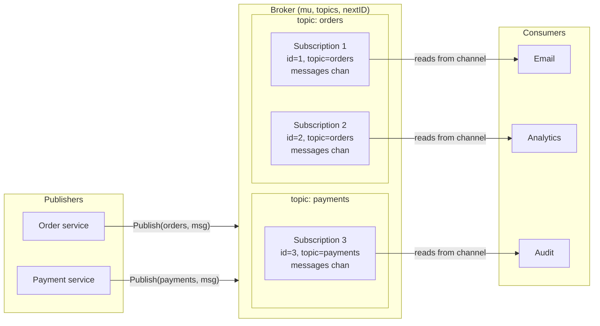
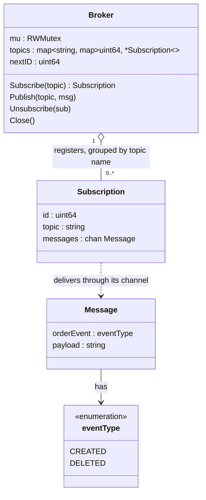
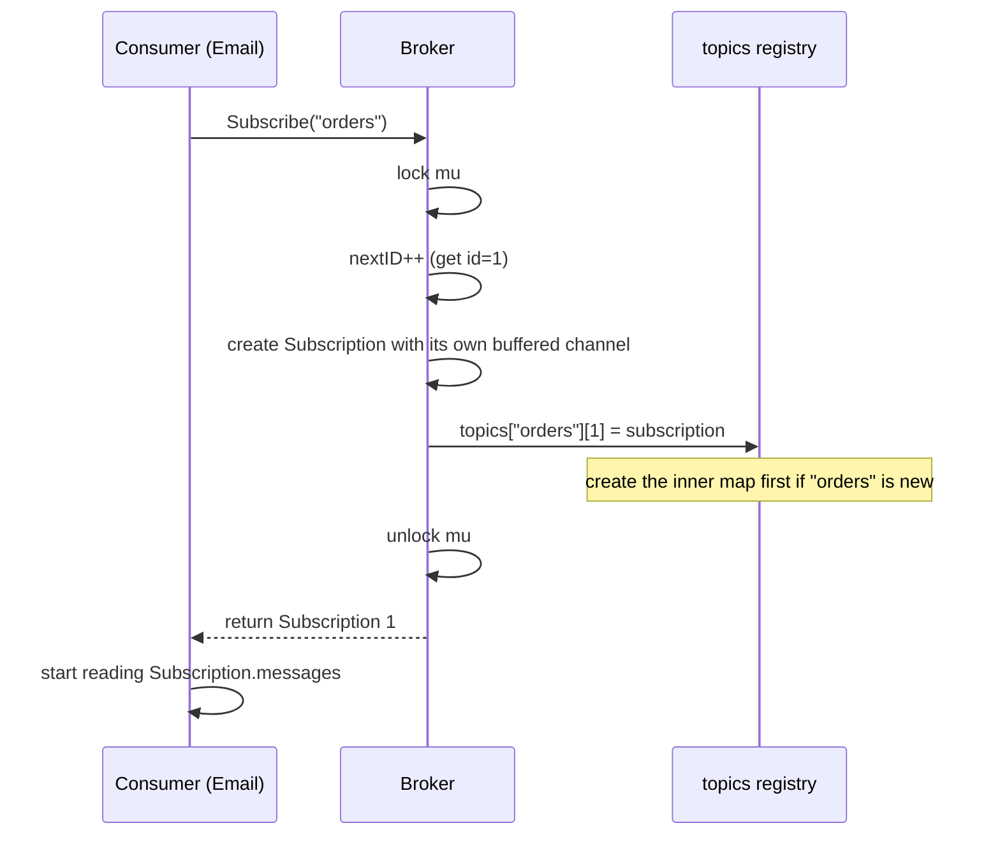
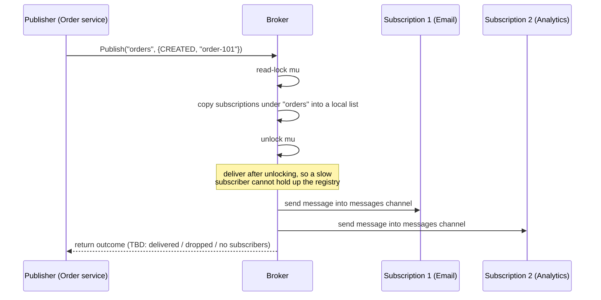
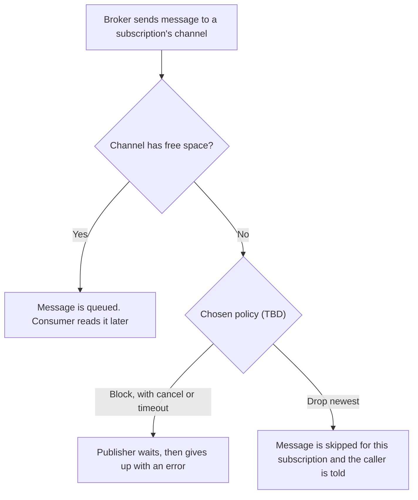
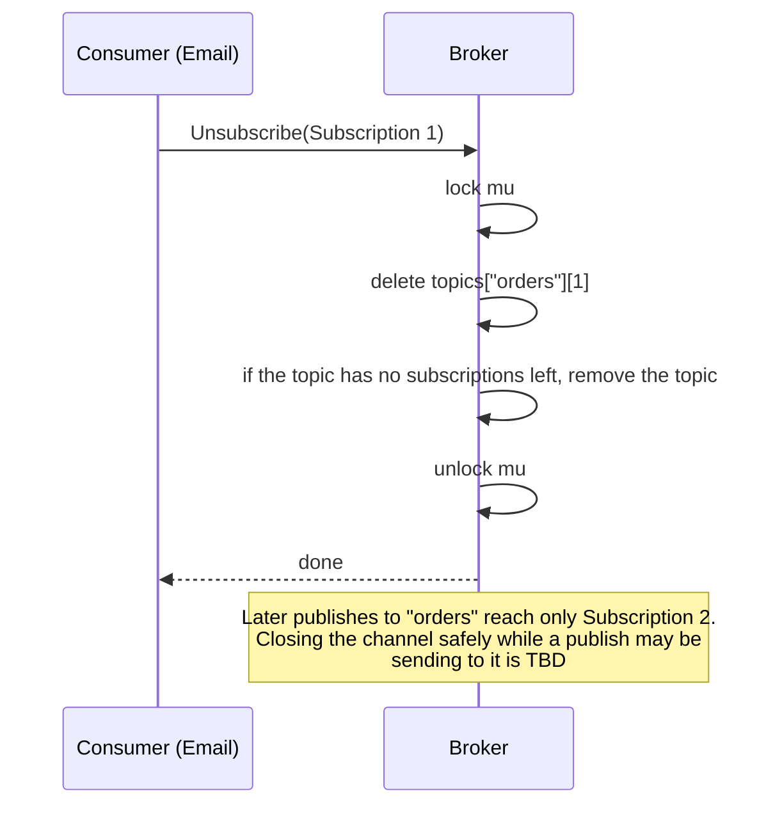
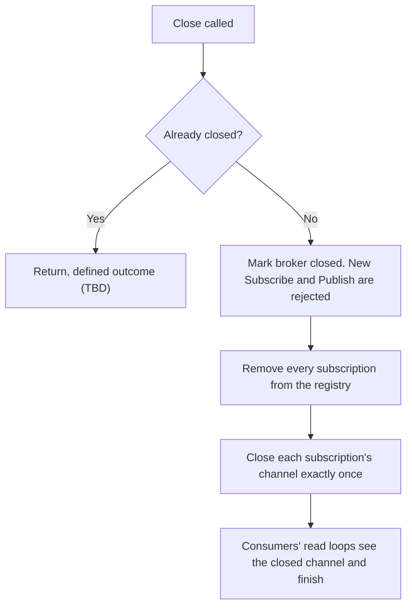
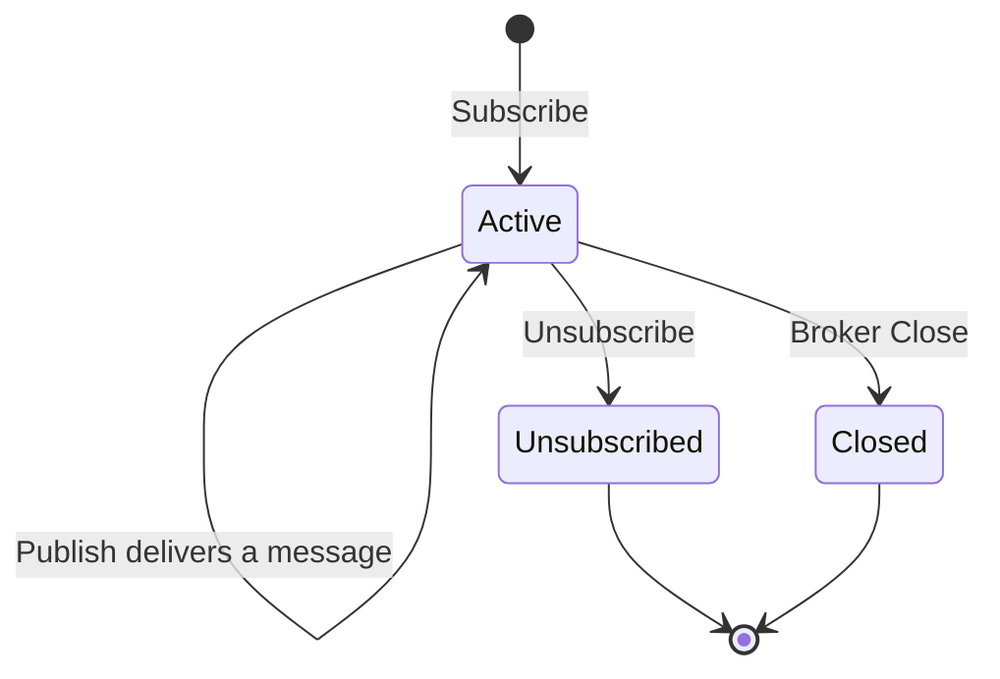

# Core Broker: Whole-System Diagrams

[Back to the problem statement](01-Core-Broker.md)

Visual map of what we are building. It uses your current structs in [types.go](types.go). Open in a Markdown preview to render the diagrams.

Open decisions (buffer-full policy, unsubscribe and close boundaries) are marked **TBD** and will be settled when we implement each operation.

## 1. The Big Picture



Reading it left to right:

- Publishers hand a message and a topic name to the broker.
- The broker looks up the subscriptions registered under that topic.
- Each subscription has its own channel, so every subscriber of the topic gets its own copy.
- Consumers read from their own channel at their own speed.

## 2. Structure: Class Diagram



The four methods on `Broker` are the planned API, not yet written.

How to read the `topics` field:

```text
topics = {
  "orders":   { 1: Subscription 1, 2: Subscription 2 },
  "payments": { 3: Subscription 3 }
}
        ^topic name     ^subscription id    ^the subscription
```

## 3. Operation: Subscribe



Why a write lock: we change the map and `nextID`, so no other caller may read or write them at the same time.

## 4. Operation: Publish



Both subscriptions get the message because each one has its own channel. One shared channel with two readers would split the messages instead of copying them.

## 5. Operation: What If a Subscriber Is Slow?



Whichever policy we choose, the buffer is finite and the outcome must be visible to the caller. That is what keeps memory bounded.

## 6. Operation: Unsubscribe



Before and after:

```text
Before: "orders" → { 1: Email, 2: Analytics }
After:  "orders" → { 2: Analytics }
```

## 7. Operation: Close



## 8. Lifecycle of One Subscription



## 9. One Full Walk-Through

Using the same example as the problem statement:

| Step | Action | Registry after the step |
|---|---|---|
| 1 | Email subscribes to `orders` | `orders → {1: Email}` |
| 2 | Analytics subscribes to `orders` | `orders → {1: Email, 2: Analytics}` |
| 3 | Audit subscribes to `payments` | `orders → {1, 2}`, `payments → {3: Audit}` |
| 4 | Publish `{CREATED, "order-101"}` to `orders` | Email and Analytics each receive it; Audit receives nothing |
| 5 | Publish `{DELETED, "order-101"}` to `orders` | Same routing. The event type is inside the message, not the topic |
| 6 | Email unsubscribes | `orders → {2: Analytics}` |
| 7 | Publish `{CREATED, "order-102"}` to `orders` | Only Analytics receives it |
| 8 | Broker closes | Registry is empty; all channels are closed |

## 10. Which Diagram Answers Which Question

| Question | Section |
|---|---|
| What things exist and how are they related? | 1 and 2 |
| What happens when someone subscribes or publishes? | 3 and 4 |
| What if the consumer is slow? | 5 |
| What happens on unsubscribe and close? | 6, 7 and 8 |
| Can I trace a concrete example? | 9 |

In an interview, draw sections 2 (structure) and 4 (publish flow) first. They show the design in about two minutes.
