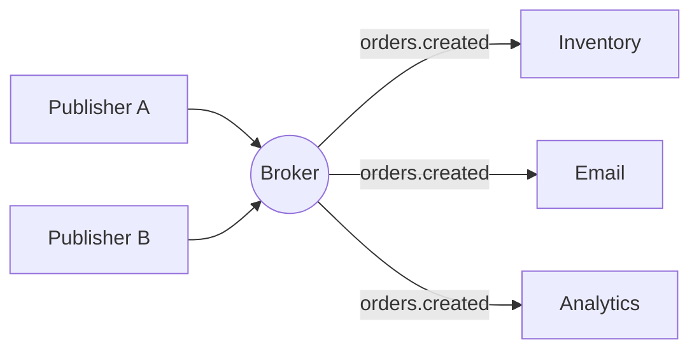
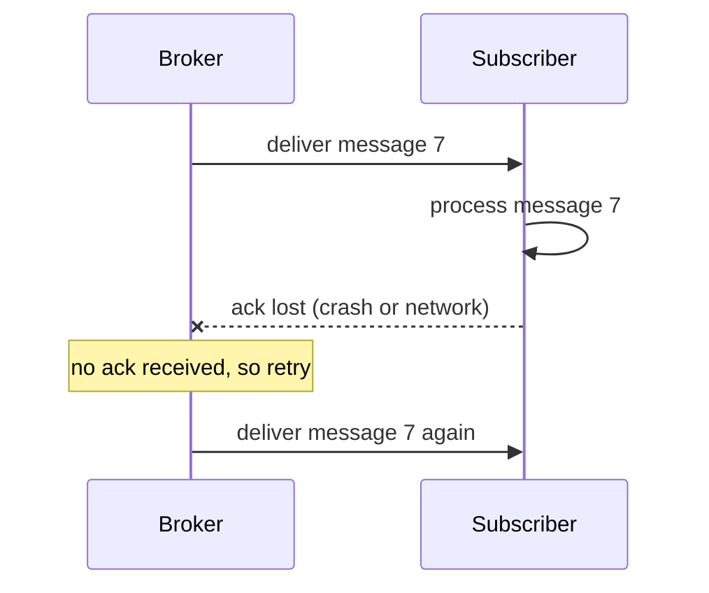
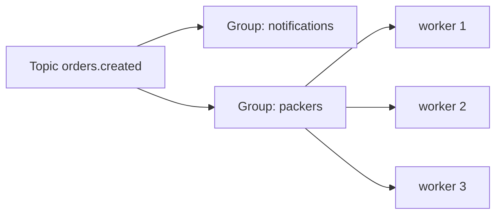

# Pub/Sub Foundations: Theory

[Back to the Pub/Sub guide](../01-Pub-Sub-System.md)

**Required depth for 3-4 YOE:** define the vocabulary, separate pub/sub from Observer and queues, state a delivery and ordering contract, and ask the right clarifying questions before coding.

## 1. The Problem It Solves

One event often has several independent reactions. When an order is placed, we may update inventory, send an email, record analytics, and refresh a cache.

If the order code calls each of those directly:

- It must import and know every consumer.
- Adding a consumer means changing the order code.
- A slow or failing consumer slows or breaks the order flow.

Pub/sub puts a **broker** in the middle. The publisher says "this happened" on a topic. It does not know who listens, how many, or what they do.

It gives **decoupling**: publishers and subscribers do not know each other, and either side can change or scale independently.

## 2. Vocabulary

| Term | Meaning |
|---|---|
| Message | The unit of data: payload plus metadata (ID, topic, timestamp, optional key) |
| Topic | A named channel that messages are published to (also called subject or channel) |
| Publisher | Sends messages to a topic. Does not know the subscribers |
| Subscriber | Registers interest in a topic and receives its messages |
| Subscription | The registration: one subscriber's interest in one topic, with its own delivery state |
| Broker | The component that holds topics and subscriptions and routes messages |

The **subscription** is the important idea. Delivery state (buffer, position, retry count) belongs to the subscription, not to the topic. That is why two subscribers on the same topic can progress at different speeds.

## 3. Pub/Sub vs. Observer vs. Queue vs. Event Bus

| | Observer | Pub/sub | Message queue |
|---|---|---|---|
| Who knows whom | Subject holds its observers directly | Neither side knows the other; the broker routes | Producer and consumer share a queue |
| Each message goes to | Every observer | Every subscriber of the topic | **One** consumer |
| Typical scope | In-process | In-process or across services | Usually across services |
| Delivery | Usually synchronous call | Usually asynchronous | Asynchronous |
| Durability | None | Depends on the system | Usually durable |
| Used for | One object notifying its dependents | Broadcasting events | Distributing work |

- **Observer** is a pattern inside your code: the subject calls observers directly. Pub/sub adds an intermediary, so the two sides are decoupled by topic name instead of by interface.
- **Queue** is for work distribution: 10 workers share a job list and each job runs once. Pub/sub is for broadcast: every interested party gets its own copy.
- **Event bus** is usually an in-process pub/sub, often with typed events. In an interview, treat it as pub/sub with a narrower scope.
- Real systems combine both. A **consumer group** (Kafka) or **queue group** (NATS) is broadcast between groups and work distribution inside a group. This is covered in the routing topic.

## 4. Push vs. Pull Delivery

| | Push | Pull |
|---|---|---|
| Who moves the message | Broker sends to the subscriber | Subscriber asks the broker |
| Pace is controlled by | Broker, so the subscriber can be overwhelmed | Subscriber, so backpressure is natural |
| Latency | Lower | Depends on polling or long-poll |
| Example | NATS, Redis, Google Pub/Sub push | Kafka, Google Pub/Sub pull |

An in-memory Go broker usually pushes into a **buffered channel per subscriber**. The channel gives a pull-like seam: the subscriber reads at its own speed, and a full buffer is where the slow-subscriber policy applies. Deciding what to do when that buffer is full is the most common follow-up (see the next topic).

## 5. Delivery Semantics

Three guarantees describe what happens when something fails between the broker and the subscriber.

| Guarantee | Meaning | Failure behavior | Cost |
|---|---|---|---|
| At-most-once | Delivered zero or one time | A message is lost if the subscriber is down or fails | Simplest and fastest |
| At-least-once | Delivered one or more times | Retried until acknowledged, so duplicates are possible | Needs acks, retries, idempotent subscribers |
| Exactly-once | Processed one time | Needs deduplication or transactions across the whole path | Hardest; usually limited in scope |

**Why at-least-once duplicates.** Delivery and acknowledgement are two separate steps:

The broker cannot tell "processed but ack lost" from "never processed". To avoid loss it must retry, which creates duplicates.

**Idempotent subscriber.** Handling the same message twice must give the same result as handling it once. Typical technique: store processed message IDs and skip repeats, or make the operation naturally repeatable (set a value instead of incrementing it).

**Exactly-once** is best understood as at-least-once delivery plus an idempotent or transactional effect. Some systems offer a limited form inside their own boundary, but your subscriber's side effects (sending an email) are outside it. In an interview, say "at-least-once with idempotent handlers" rather than claiming exactly-once.

**An in-process Go broker is at-most-once by nature.** Messages live in memory, so a crash loses them, and a full buffer may drop them. Say this explicitly. Reliability is added later with acks and retries.

## 6. Ordering

Ordering is a separate promise from delivery. Decide which one you give:

| Level | Meaning | Cost |
|---|---|---|
| No ordering | Messages may arrive in any order | Cheapest; allows parallel delivery |
| Per-subscriber FIFO | Each subscriber sees messages in publish order | One delivery loop per subscriber |
| Per-key ordering | Messages with the same key keep their order | Same key always goes to the same worker or partition |
| Total ordering | Every subscriber sees one global order | Needs a single serialization point; limits throughput |

- With one publisher and one buffered channel per subscriber, per-subscriber FIFO is natural.
- With several concurrent publishers, "publish order" is only defined by when each call takes its turn. Say what you mean by it.
- Retries break order unless the system waits for the failed message before sending the next one. This is why Kafka orders within a **partition** and Google Pub/Sub uses **ordering keys**.

A safe interview default: **FIFO per subscriber on a topic, no ordering across topics.**

## 7. Broadcast vs. Competing Consumers

Two different routing intents are both called "subscribing":

| Intent | Delivery | Example |
|---|---|---|
| Broadcast | Every subscriber gets a copy | Email, analytics and cache each need every order |
| Competing consumers | Exactly one member of a group gets each message | Three workers share the packing jobs |

Every group receives each message, but inside a group only one member does. A group of one is plain broadcast. This is built in a later topic; for now know that it exists and how it is described.

## 8. How Real Systems Differ

| System | Default semantics | Persistence and replay | Notable idea |
|---|---|---|---|
| Redis Pub/Sub | At-most-once; a message is lost if the subscriber is down or fails | None (Redis Streams adds it) | Channels and pattern subscriptions |
| NATS core | At-most-once; only to currently connected subscribers | None (JetStream adds it) | Subjects with `*` and `>` wildcards; queue groups |
| Google Pub/Sub | At-least-once; redelivery after the ack deadline | Optional retention and seek | Per-message acks; optional ordering keys and exactly-once; dead-letter topics |
| Kafka | At-least-once by default | Durable partitioned log, replayable by offset | Partitions give ordering and scale; each partition goes to one consumer in a group |

Use this table as the answer to "how would you scale this beyond one process?" The in-memory design you build matches the Redis and NATS core model; the later reliability topic moves it toward Google Pub/Sub, and the replay part toward Kafka.

## 9. Clarifying Questions and Our Contract

Ask these before writing code. The answers define the design.

| Question | Why it matters | Default we will build |
|---|---|---|
| In-process or across services? | Decides durability, networking, serialization | In-process, single Go process |
| Must messages survive a crash? | Decides memory vs. storage | No. In-memory, at-most-once first |
| Does every subscriber get every message? | Broadcast vs. competing consumers | Broadcast; groups added later |
| What if a subscriber is slow? | Block, drop, or buffer without bound | Bounded buffer per subscriber with a chosen policy |
| What ordering is required? | Decides concurrency in delivery | FIFO per subscriber per topic |
| Can subscribers join late and see history? | Decides if messages are stored | No history first; replay added later |
| Are there wildcard topics? | Decides matching structure | Exact match first; wildcards added later |
| Scale: topics, subscribers, publish rate? | Decides locking and goroutine strategy | Thousands of topics, many subscribers |

## 10. Interview Recap

1. **Define it:** publishers send to topics through a broker; subscribers receive from topics; neither side knows the other.
2. **Separate it from neighbors:** Observer is a direct in-process call; a queue gives each message to one consumer; pub/sub gives each message to every subscriber.
3. **State semantics explicitly:** at-most-once vs. at-least-once vs. exactly-once, and say an in-memory broker is at-most-once.
4. **Say why duplicates occur:** a lost ack forces a retry, so at-least-once needs idempotent subscribers.
5. **State ordering:** per-subscriber FIFO is a reasonable default; stronger ordering costs concurrency.
6. **Name the slow-subscriber problem early:** a bounded buffer needs a policy: block, drop, or time out.
7. **Know the scale-up answer:** Kafka gives partitions and replay; Google Pub/Sub gives per-message acks; Redis and NATS core are fire-and-forget.

### Self-check

- Why does a subscription, not the topic, hold delivery state?
- Why can't a broker distinguish "processed but ack lost" from "never processed"?
- Why is "exactly-once" usually really at-least-once plus idempotency?
- Why do retries threaten ordering, and what do Kafka and Google Pub/Sub do about it?
- When is a queue the right tool instead of pub/sub?

## References

- [Redis Pub/Sub: delivery semantics](https://redis.io/docs/latest/develop/pubsub/)
- [NATS core: at-most-once delivery and queue groups](https://docs.nats.io/learn/core-nats/)
- [Google Pub/Sub: subscriptions, ack deadline, at-least-once](https://docs.cloud.google.com/pubsub/docs/subscription-overview)
- [Hello Interview: Kafka deep dive (partitions, consumer groups)](https://www.hellointerview.com/learn/system-design/deep-dives/kafka)
- [ashishps1/awesome-low-level-design: Pub-Sub problem](https://github.com/ashishps1/awesome-low-level-design/blob/main/problems/pub-sub-system.md)
