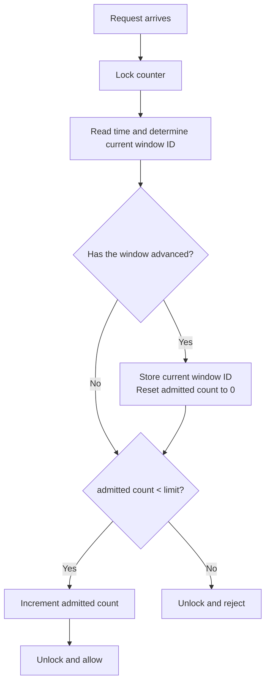

# Fixed-Window Counter: Theory First

[Back to the rate-limiter roadmap](../01-Rate-Limiter.md)

**For 3-4 YOE Go interviews:** explain the contract, window boundaries, lazy reset, atomic admission, and boundary-burst limitation.

**Scope:** theory, examples, flow diagram, and a minimal single-process Go implementation.

## 1. The Problem It Solves

Suppose the requirement is:

> "Each user may make at most five requests per clock minute. Reject excess requests. A new allowance becomes available at the next minute."

We need to count requests within an agreed time interval and start a fresh count when that interval ends.

A fixed-window counter divides time into **non-overlapping, aligned windows**:

```text
Window A: [12:00:00, 12:01:00)
Window B: [12:01:00, 12:02:00)
Window C: [12:02:00, 12:03:00)
```

The opening boundary is included; the closing boundary belongs to the next window. A request at exactly 12:01:00 belongs to B, not A.

**Simple mental model:** one request counter for the current time slot.

## 2. Where It Is Used

| Use case | Why it fits |
|---|---|
| Simple per-user or per-API-key minute quotas | Small, constant-size counting state |
| Hourly or daily usage allowances | Matches an explicitly agreed reset boundary |
| Coarse admission protection | Cheap decisions when boundary bursts are acceptable |

Examples:

- 100 admitted requests per UTC clock minute per API key.
- 1,000 admitted operations per UTC hour per tenant.

Do not assume every external API's "100/minute" rule means fixed windows. Clarify the actual contract.

A calendar day in a local time zone can be shorter or longer than 24 hours around daylight-saving changes. A fixed 24-hour UTC interval and a local-midnight quota are not automatically equivalent. Our exercise uses fixed-duration, aligned windows.

## 3. When It Is Not the Right Policy

| Required promise | Better fit |
|---|---|
| Never exceed N requests in any rolling W seconds | Exact sliding-window log |
| Earn allowance continuously and save a bounded burst | Token bucket |
| Limit operations currently executing | Concurrency limiter |
| Release queued work at an even pace | Queue-based traffic shaper |

Fixed-window counting is exact **within its own windows**, but does not smooth traffic or enforce an exact rolling quota.

## 4. Our Contract for This Lesson

```text
Limit:       5 admitted requests
Window:      1 clock minute, aligned to minute boundaries
Owner:       one user in the worked examples
Scope:       one Go process
Exhaustion:  reject immediately
Charging:    count admission, not eventual success
Carry-over:  none
```

- Different users have independent counts if the surrounding system maintains per-user state.
- An admitted request counts even if its handler later fails.
- A request rejected by this limiter does not increment the admitted count.
- Each new window has a fresh allowance, not the old allowance plus a refill.
- A per-user registry and HTTP integration are separate from the core counter.

An alternative policy may count all attempts, including rejected ones. That is a different charging contract; we will count admitted requests.

## 5. How Do We Decide Which Window a Request Belongs To?

Choose a shared reference boundary, called an **anchor**. For timestamps at or after that anchor:

```text
window ID = floor(elapsed time since anchor / window duration)
```

For an easy example, let the anchor be 12:00:00 and the duration be 60 seconds:

| Request time | Elapsed seconds | Window ID |
|---|---:|---:|
| 12:00:00 | 0 | 0 |
| 12:00:45 | 45 | 0 |
| 12:00:59.999 | 59.999 | 0 |
| 12:01:00 | 60 | 1 |
| 12:01:25 | 85 | 1 |
| 12:03:00 | 180 | 3 |

There is no need to visit empty windows 1 and 2 if the next request after window 0 arrives in window 3. Recognize the current window and begin its count at zero.

For epoch-aligned fixed-duration windows, the same idea is:

```text
window ID = floor(Unix timestamp / window duration)
```

Use matching time units. A duration in nanoseconds cannot be divided into a timestamp in seconds without conversion.

**Alignment matters:** starting a new private window at each user's first request produces a different reset schedule. That is not our shared clock-minute contract.

## 6. Worked Example

Assume a limit of five admissions per clock minute:

| Time/event | Current window's count afterward | Decision |
|---|---:|---|
| First request at 12:00:10 | 1 | Allow |
| Four more requests before 12:01:00 | 5 | Allow all four |
| Another at 12:00:40 | 5 | Reject |
| Another at 12:00:59 | 5 | Reject |
| First request at 12:01:00 | 1 | New window: reset to zero, then admit |

The failed checks do not move the reset boundary. It stays 12:01:00.

### What happens to leftover allowance?

Suppose the user only makes two requests in window A:

```text
Window A: limit 5, admitted 2, unused allowance 3
Window B: limit 5, admitted count starts at 0
```

The three unused admissions expire. Window B permits five, not eight.

This differs from a token bucket, which keeps unused tokens up to capacity.

## 7. Lazy Reset: No Background Runner

Nothing needs to run exactly at the boundary.

On the next request:

1. Determine the request's current window ID.
2. Compare it with the stored window ID.
3. If the window has advanced, replace the stored ID and reset the count to zero.
4. Check the limit.
5. If allowed, increment and admit; otherwise reject.

Example:

```text
Last activity: 12:00:30, count = 5
No activity for several minutes.
Next request: 12:04:10

Current window differs from the old window.
Start the current count at 0.
Admit the request and make count = 1.
```

The old count can remain in memory during inactivity because it is recognized as stale before it is used.

**This is reset, not refill.** We do not calculate earned tokens, retain fractions, or add unused allowance.

This assumes a suitable non-decreasing decision-time policy. Backward clock changes need explicit handling; blindly resetting whenever IDs differ can reopen an old window and grant extra allowance.

## 8. Flow Diagram: Core Admission

Assume valid configuration, initialized state, and a non-decreasing window ID. This diagram shows one shared counter; per-user lookup would happen before entering it.



If integrated with HTTP, rejection normally maps to 429. Business logic executes only after unlocking. No count is returned when a handler finishes.

**Memorize:**

```text
Lock -> Find window -> Reset if advanced -> Check -> Increment if allowed
     -> Unlock -> Allow or reject
```

## 9. The Main Interview Follow-Up: Boundary Bursts

Suppose the limit is 100 per clock minute:

```text
12:00:59.900 -> 100 requests admitted in window A
12:01:00.100 -> 100 requests admitted in window B
```

That is 200 admissions in approximately 200 ms.

Did the algorithm fail? **No.** Each aligned window admitted at most 100. The problem is that this contract permits a large burst around a boundary.

The user can also send the entire allowance at the start of a window. Fixed-window counting does not space requests evenly.

If the requirement changes:

- **Strict rolling count:** consider a sliding-window log.
- **Approximate rolling count with low state:** consider a sliding-window counter.
- **Sustained rate with explicit burst allowance:** consider a token bucket.

Do not claim that fixed-window counting enforces "at most 100 in every 60-second interval."

## 10. Compare It with Token Bucket

| Question | Fixed-window counter | Token bucket |
|---|---|---|
| What is the allowance? | N admissions per aligned window | Tokens earned at rate r, saved up to B |
| How does allowance return? | Fresh count at a window boundary | Gradually with elapsed time |
| Does unused allowance carry over? | No | Yes, up to capacity |
| Empty/exhausted early? | Wait for next boundary | Wait until enough tokens accumulate |
| Need a background runner? | No: lazy reset | No: lazy refill |
| Strict rolling-count guarantee? | No | No |
| Primary parameters | Limit and window duration/alignment | Rate and capacity |

If the user exhausts a minute quota at 12:00:10, the next allowance starts at 12:01:00. If exhausted at 12:00:59, the wait is only one second. The waiting time depends on the boundary, not on the last admission.

## 11. Go Interview Considerations, Without Code

### Atomicity

Time/window detection, reset, check, and increment must be one synchronized operation.

Otherwise two callers can both observe one remaining admission and exceed the limit. A reset can also overwrite another caller's increment if it is not coordinated.

A mutex is a clear starting point. An atomic count alone does not coordinate the count with its window identity.

### Time

Read decision time inside the relevant lock. Define whether the policy uses wall-clock alignment or a process-local anchored timeline.

Go's monotonic elapsed-time calculations help with local durations, but converting to Unix timestamps uses wall time. Explicit clock-minute alignment and resilience to clock jumps require a deliberate policy.

### Scope and lifecycle

- Independent counters on multiple replicas do not enforce one global quota.
- Restarting an in-memory limiter forgets the current count and may grant extra admissions.
- Per-user state needs bounded storage and safe cleanup.
- Removing an active user's state too early can recreate a fresh allowance in the same window.

Keep these as follow-ups. We will first implement a single-process core counter, then extend only as required.

## 12. Tests We Will Write Later

| Scenario | Expected outcome |
|---|---|
| N requests within one window | All admitted |
| Request N+1 in that window | Rejected |
| Just before closing boundary | Still uses old count |
| Exactly at next boundary | Fresh count; request admitted |
| Skip several windows | Reset once to the current window |
| Unused allowance | Does not increase next window's limit |
| Concurrent calls at fixed decision time | Exactly N admissions |
| Boundary-burst example | Both window allowances permitted |

Use controlled time rather than sleeps for precise boundary tests. When coding, also validate configuration and define the clock-backward policy.

## 13. Interview Recap

**One sentence:**

> "A fixed-window counter admits up to N requests in each aligned time window, lazily resets stale state when the window advances, and atomically checks and increments the admitted count."

**Five rules:**

1. Windows do not overlap.
2. An exact closing boundary belongs to the next window.
3. Unused allowance does not carry over.
4. Reset/check/increment must be atomic.
5. Adjacent windows can permit almost simultaneous bursts totaling twice the limit.

### Quick self-check

1. If a user uses all five requests at 12:00:10, when is the next allowance available?
2. If only two are used, does the next window permit eight?
3. What code needs to run at the boundary if no request arrives?
4. Is a new window measured from the last rejected request?
5. Why can 100/minute allow 200 requests in about 200 ms?

**Answers:** (1) 12:01:00; (2) no, five; (3) none with lazy reset; (4) no, boundaries stay aligned; (5) the requests use two adjacent windows' allowances.

## 14. Current Go Implementation

- [fixedWindow.go](fixedWindow.go): one shared counter with remaining allowance and mutex-protected admission.
- [fixedWindow_test.go](fixedWindow_test.go): capacity, stale-window reset, and concurrent admission tests.

Construct it with an explicit duration, for example `NewFixedWindow(5, time.Minute)`. The second argument is now a `time.Duration`, not an integer number of hours.

The constructor initializes the current window and full balance. Admission reads time inside the lock and calculates `windowEnd = windowStart.Add(windowDuration)`. If `!now.Before(windowEnd)`, the window has expired, including when `now` equals its end. Reset the balance and use `now.Truncate(windowDuration)` to find the new aligned start, even if several windows were skipped. Then consume one unit if available.

Alignment uses `time.Time.Truncate`: fixed-duration boundaries measured from Go's zero time. Minutes and hours align to UTC clock boundaries; this is not a general local-midnight calendar policy or Unix-epoch alignment for every possible duration.

If wall time moves backward, the counter retains its current window and allowance until time advances past that window. It does not reopen an older allowance.

As in our token-bucket exercise, configuration validation is deferred: callers must supply positive capacity and a positive duration. Per-user storage, HTTP integration, and cross-replica coordination are not implemented.

From the rate-limiter module folder:

```powershell
go test -race .\Fixed_Window_Counter
go vet .\Fixed_Window_Counter
```

The tests isolate allowance checks from real boundary crossings and verify stale-state alignment. Exact timestamp-controlled boundary tests remain a later exercise.
