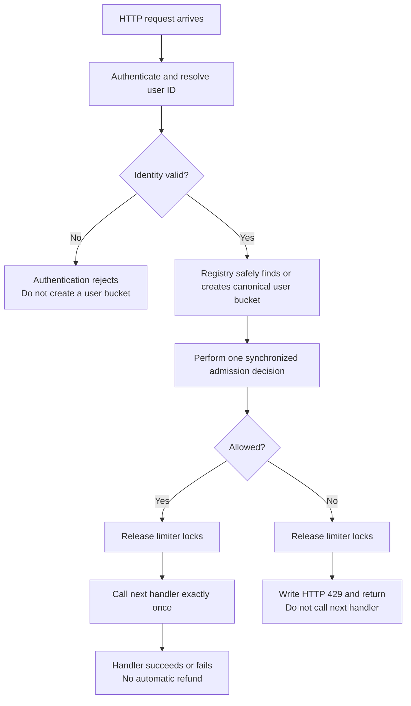

# Per-User HTTP Rate Limiter: Theory First

[Back to the roadmap](../01-Rate-Limiter.md) | Prerequisite: [Token bucket](../Token_Bucket/01-Token-Bucket.md)

**For 3-4 YOE Go interviews:** turn one concurrency-safe bucket into per-user HTTP admission. Understand state ownership, identity, middleware, and lifecycle before coding.

**Scope:** theory, worked examples, flow diagrams, and staged implementation goals. No Go solution is included.

## 1. The Problem We Are Solving

Our existing token bucket answers:

> "Can one more request use this bucket?"

It does not answer:

- Which user's bucket should this request use?
- How do concurrent requests find the same bucket?
- How does HTTP rejection work?
- What happens to buckets after users stop making requests?

We need surrounding application logic, not another rate-limiting algorithm.

```text
Token bucket       -> accounts for one allowance
User registry      -> assigns the correct allowance
HTTP middleware    -> enforces admission before business work
Lifecycle policy   -> bounds state without granting extra allowance
```

## 2. Our Contract

| Decision | Policy for this exercise |
|---|---|
| Identity | Authenticated user ID |
| Algorithm | Token bucket |
| Rate | 2 tokens/second per user |
| Capacity | 3 tokens per user |
| Initial state | New bucket starts full |
| Cost | One token per admitted request |
| Exhaustion | Reject immediately with HTTP 429 |
| Scope | One Go process |
| Sharing | One budget per user across routes covered by this limiter instance |
| Charging | Admission counts; handler failure does not refund |

The initial core registry exercise may defer cleanup, but must acknowledge unbounded growth. Safe bounded storage is a later stage of this same lesson.

### Example: user isolation

Ignore refill during these immediate requests:

```text
Alice sends 4 requests -> allow 3, reject 1
Bob sends 1 request   -> allow
```

Alice does not consume Bob's allowance.

But Alice calling two protected endpoints still uses Alice's same budget. Separate per-endpoint budgets would require a different key, such as user ID plus endpoint class.

## 3. The Registry: One User, One Active Bucket

The registry is a shared mapping:

```text
Alice's ID -> Alice's bucket
Bob's ID   -> Bob's bucket
```

Each entry can also track activity for cleanup.

### Existing user

Find the existing bucket and use it. Do not reset it on lookup.

### First request from a user

Create and publish one bucket, then use it for the admission decision.

### Why not create a bucket on every request?

Every request would receive a new full allowance:

```text
Request 1 -> new full bucket -> allowed
Request 2 -> new full bucket -> allowed
Request 3 -> new full bucket -> allowed
...
```

There is no meaningful enforcement unless the state survives between requests.

### Why store pointers?

Requests need to mutate the same bucket, not independent copies. Copying a bucket containing an already-used mutex is also incorrect.

The Go map is not safe for concurrent access when writes can occur; protecting individual buckets does not protect the map.

## 4. Concurrent First Requests: The Duplicate-Bucket Bug

Suppose Alice has no entry yet:

```text
Request A looks up Alice -> absent
Request B looks up Alice -> absent
A creates full bucket X
B creates full bucket Y
A uses X; B uses Y
```

Two separately usable allowances exist for one user. Making each bucket thread-safe does not solve this.

**Required guarantee:** lookup and creation must publish one canonical bucket per key. Every request must use that canonical bucket, including callers that lose a concurrent creation race.

The simplest interview starting point is a mutex around registry access. An optimization using a read lock still needs a second lookup under the write lock before creation.

`sync.Map` is an alternative when justified, not an automatic solution to bucket lifetime or cleanup.

## 5. Who Owns Which Lock?

There are two different kinds of shared state:

| State | Protection |
|---|---|
| Map entries, creation, activity/lifecycle metadata | Registry synchronization |
| Tokens and refill timestamp | Bucket synchronization |

### Start simple

For a small interview solution, a registry lock can remain held while calling the bucket's short, non-blocking admission method.

This serializes registry operations across users, but makes admission and later cleanup easier to coordinate. The bucket method still owns its internal mutex.

If both locks are acquired, use a consistent order:

```text
Registry lock -> bucket lock
```

Do not introduce a reverse path that can deadlock.

### Optimize only when needed

Releasing the registry lock after retrieving a pointer reduces contention. Before adding deletion, however, explain what prevents cleanup from removing that entry while a request still holds the pointer.

Possible designs coordinate entry use and eviction with references, entry locks, or a simpler registry-wide critical section. We do not need to implement all of them.

**Never hold these locks while executing the HTTP handler, writing network responses, or waiting for tokens.**

## 6. Identity Must Be Trustworthy

For this exercise, authentication determines the user ID before per-user limiting.

```text
Request -> authentication -> per-user limiter -> business handler
```

- Do not let a client select an arbitrary user ID to obtain a fresh allowance.
- Avoid a shared empty-string bucket caused by missing identity.
- Missing/invalid credentials belong to the authentication policy, usually HTTP 401, not a quota-exhausted 429.
- In tests, a trusted identity provider can supply a user ID without building a complete authentication system.

IP-based limits are a different policy. NAT can group many users under one IP, and forwarded headers are trustworthy only under a defined proxy setup.

This limiter does not protect expensive authentication work that happens before it. A separate coarse pre-authentication control may be useful, but is outside the first exercise.

## 7. HTTP Middleware: Where the Decision Is Enforced

Middleware wraps the next handler. Its job is to decide whether to call that handler at all.



The middleware/registry must be constructed once and shared by requests. Constructing a fresh limiter inside the handler resets state.

### Rejection behavior

- Use 429 for an exhausted per-user allowance.
- Return a stable, documented error response.
- Return immediately after rejection so execution cannot fall through to the handler.
- Do not execute the protected work first and check the limiter afterward.

`Retry-After` is optional. A correct value may require extending a boolean-only admission API to return retry information from the same accounting decision.

Do not call `Allow` twice to find out whether a request should pass; it consumes budget.

For our simple bucket, a token-deficit/rate calculation can estimate the delay. Round a positive fractional delay up to integer seconds when using that HTTP header format. It is not a reservation; competing requests may consume the token first.

## 8. Why Reject Instead of Wait?

A public HTTP server that waits for every exhausted user can accumulate:

- Waiting goroutines.
- Open connections.
- Request memory.
- Clients whose deadlines expire before execution.

For this exercise, reject immediately. The caller can retry according to documented guidance.

Context-aware waiting is useful for outbound clients or background work. We will practice it separately, not make inbound middleware block by default.

## 9. Replacing the Custom Bucket with `golang.org/x/time/rate`

The architecture stays the same:

```text
Identity -> registry -> bucket admission -> HTTP allow/reject
```

Only the bucket-accounting component changes.

| Concern | Custom bucket | `x/time/rate` |
|---|---|---|
| Token refill and consumption | We implemented it | Library provides it |
| Safe concurrent bucket operations | Our mutex | Library provides it |
| Immediate admission | Our admission method | `Allow` |
| Cancellable waiting | Not currently implemented | `Wait` / `WaitN` |
| Future reservation | Not currently implemented | `Reserve` / `ReserveN` |
| Identity extraction | Application responsibility | Application responsibility |
| Per-user registry and canonical creation | Application responsibility | Application responsibility |
| Eviction and memory limits | Application responsibility | Application responsibility |
| HTTP responses | Application responsibility | Application responsibility |
| Global budget across replicas | Not provided | Not provided |

For the example policy, configure a rate of two tokens/second and burst capacity three.

The library is an external Go module, not the standard library. Its limiter is initially full when created through its constructor and supports concurrent use.

Use `Allow` for immediate admission. Knowing that `Wait(ctx)` respects cancellation is sufficient here; there is no need to implement library internals.

**Comparison exercise later:** replace the custom bucket without rewriting identity handling and HTTP behavior. Avoid building a large generic algorithm framework just for this swap.

## 10. Memory Growth and Safe Cleanup

With K users, the registry has O(K) bucket entries. Lazy token refill eliminates refill goroutines, not stored user state.

### Why arbitrary TTL eviction is wrong

Suppose Alice empties her bucket. A short idle timeout removes it before enough allowance has returned.

Her next request creates a new full bucket. Deletion granted budget the refill policy had not earned.

### The old-pointer race

```text
A gets a pointer to Alice's old bucket.
Cleanup deletes the entry.
B creates and uses Alice's new bucket.
A resumes and uses the old bucket.
```

One identity now has two usable budgets. Map deletion alone does not coordinate entry lifetime.

### A simple policy for our token bucket

For a fixed positive rate, capacity B, and no future reservations:

```text
maximum time to refill from empty = B / rate
```

Our example has capacity three and rate two/second:

```text
3 / 2 = 1.5 seconds
```

After at least that much genuine inactivity, even an empty bucket would be full. Recreating it full can preserve accounting.

Conditions still matter:

- Track the latest use consistently, including rejected attempts.
- Choose idle expiry at least as long as the full-refill duration.
- Coordinate lookup, use, activity updates, and removal.
- Do not remove an entry while a caller can still use its old bucket.
- Keep rate/capacity fixed for this exercise.
- Reservations, zero refill rates, and dynamic policies need different reasoning.

With the simple registry-wide critical section from section 5, cleanup can use the same lock to exclude admissions while evaluating/removing entries.

A periodic cleaner needs cancellation and an owner that waits for it to stop. A bounded opportunistic sweep is another option. Neither requires one goroutine per user.

### Does idle cleanup guarantee a hard memory bound?

No. Many active identities can still create many entries. A hard maximum needs an explicit policy when full.

Do not evict active entries merely to make room if doing so resets allowance. Options include rejecting new registry entries or using external storage, with clearly documented failure behavior.

Distinguish inability to track/enforce a user from normal quota exhaustion. Do not silently admit everything or automatically label a registry-capacity error as 429.

## 11. Tests We Will Write

| Scenario | What it proves |
|---|---|
| Alice exhausts her bucket; Bob makes a request | User budgets are independent |
| Concurrent first requests for Alice | One canonical budget, not one per caller |
| Same user calls two protected routes | Sharing matches our contract |
| Allowed request | Next handler executes exactly once |
| Rejected request | 429; next handler is never called |
| Handler fails after admission | No refund under the chosen contract |
| Missing identity | No anonymous/empty-key bucket created |
| Registry reused across requests | No fresh allowance per HTTP request |
| Cleanup before safe idle threshold | Budget is retained |
| Cleanup after safe idle threshold | Safe recreation without extra allowance |
| Cleanup concurrent with lookup/admission | No duplicate usable entry |
| Custom bucket replaced with library bucket | Same external policy and HTTP behavior |

Go's `net/http/httptest` can exercise middleware without opening a real listening server. Use a handler that records whether it ran.

Use controlled time for refill/eviction boundaries and race-enabled tests for concurrent code. A sleep-only demo is not a deterministic proof of user isolation or safe creation.

## 12. Scope: What This Still Does Not Solve

Two application replicas have two registries:

```text
Replica A: Alice's bucket
Replica B: Alice's independent bucket
```

The same user can consume both allowances. Using `x/time/rate` does not change this.

Also:

- Restart loses in-memory budgets.
- One user budget does not cap total service traffic from many users.
- Rate limiting does not bound active work when handlers slow down.
- User isolation is not a FIFO fairness guarantee.

Shared distributed accounting, global limits, and concurrency control are separate follow-ups.

## 13. Implementation Stages for Our Exercise

We will implement one stage at a time, not reveal the complete solution upfront.

1. **Registry:** reuse the custom token-bucket behavior; safely find/create one bucket per user.
2. **Middleware:** resolve trusted identity, admit or return 429, and call the next handler only when allowed.
3. **Focused tests:** prove user isolation, canonical creation, and handler behavior.
4. **Library comparison:** use `x/time/rate` for bucket accounting while preserving the surrounding design.
5. **Lifecycle:** add a safe idle policy, bounded-state behavior, and cleanup tests.

Do not start by importing the existing demo's `package main` as a reusable library. During implementation, choose a small reusable package boundary or a self-contained exercise layout deliberately. We will not duplicate or restructure everything merely to start the theory.

## 14. Interview Recap

> "I keep one canonical token bucket per authenticated user in a synchronized registry. Middleware uses that shared registry to make an immediate admission decision before calling the handler. Exhaustion returns 429. Bucket safety and registry safety are separate concerns. I make cleanup preserve budget and coordinate with active callers. A library bucket can replace my accounting, but identity, lifecycle, HTTP behavior, and replica-wide scope remain application responsibilities."

### Quick self-check

1. Why is a new bucket per request incorrect?
2. Why is a thread-safe bucket not enough for a shared map?
3. What happens if two first requests create separate buckets?
4. Does `x/time/rate` supply per-user cleanup?
5. Why can a short TTL reset an exhausted user's allowance?
6. Does this enforce one budget across all replicas?

**Answers:** (1) every request gets fresh budget; (2) the registry has its own shared mutable state; (3) one user can spend separate allowances; (4) no; (5) recreation may grant tokens not yet earned; (6) no, scope is one process.

## References

- [Go rate package](https://pkg.go.dev/golang.org/x/time/rate).
- [Go HTTP handlers and middleware building blocks](https://pkg.go.dev/net/http#Handler).
- [Go HTTP test helpers](https://pkg.go.dev/net/http/httptest).
- [Go mutex documentation](https://pkg.go.dev/sync#Mutex).
