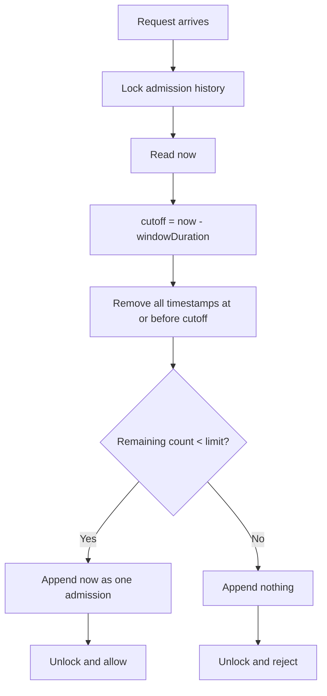

# Sliding-Window Log: Theory First

[Back to the rate-limiter roadmap](../01-Rate-Limiter.md)

**For 3-4 YOE Go interviews:** explain the rolling contract, timestamp expiration, atomic admission, and accuracy/memory trade-off.

**Scope:** theory, worked examples, flow diagram, and a minimal slice-based Go implementation.

## 1. The Problem It Solves

Suppose the requirement is:

> "Allow at most three admitted requests in any rolling ten-second interval. Reject excess requests."

A fixed-window counter cannot enforce this exact promise. Requests on opposite sides of a fixed boundary use different allowances.

For example, with a fixed limit of three per ten-second slot:

```text
t=9.9s  -> admit three requests in the first slot
t=10.1s -> admit another three in the next slot
```

That is six admissions in about 200 ms.

A sliding-window log instead asks on every request:

> "How many requests were admitted during the last ten seconds, measured from now?"

**Simple mental model:** keep a recent-admission history; remove expired entries before making a decision.

"Log" means a collection of timestamps here, not application logging to a console or file.

## 2. Where It Is Used

| Use case | Why it fits |
|---|---|
| Strict per-user or API-key rolling quotas | Enforces an exact recent admission count |
| Limiting admitted password-reset or verification actions | Remembers exactly when counted actions were admitted |
| Low/moderate-volume sensitive endpoints | Exactness may justify the timestamp storage |

Clarify what counts. A rule about all failed login attempts is not automatically the same as our rule about admitted requests.

## 3. When It Is Not the Right Policy

| Requirement | More direct mechanism |
|---|---|
| Reset allowance at the next clock minute or midnight | Fixed-window/calendar quota |
| Average rate with separately configured burst capacity | Token bucket |
| Low-memory approximate rolling count | Sliding-window counter |
| Maximum operations executing simultaneously | Concurrency limiter |
| Evenly paced release of queued work | Traffic shaper |

An exact rolling quota still allows a burst of up to the limit. Three requests can arrive together if the recent history is empty. Exact counting does not mean evenly spaced requests.

## 4. Our Contract for This Lesson

```text
Limit N:      3 admitted requests
Duration W:   10 seconds
Interval:     (now - W, now]
Scope:        one Go process
Exhaustion:   reject immediately
Charging:     admission, not eventual success
State:        timestamps of admitted requests
```

The first implementation will manage one shared history. A per-user design would maintain one independent history per user.

- A fresh history is empty, so up to three requests may pass immediately.
- An admission appends one timestamp.
- A rejection appends nothing.
- A later handler failure does not remove its admission timestamp.
- No fixed reset boundary, token refill, or background runner is required.

## 5. What Is a Rolling Window?

The duration stays fixed, but both boundaries move with the current time.

For a ten-second duration:

| Now | Relevant admission interval |
|---|---|
| t=9s | (-1s, 9s] |
| t=10s | (0s, 10s] |
| t=12s | (2s, 12s] |
| t=20s | (10s, 20s] |

These windows overlap. They are not the separate slots `[0,10)`, `[10,20)`, and so on.

There is no single saved "current window" that eventually resets in full. Determine the cutoff from the current request time.

## 6. Timestamp Expiration

Calculate:

```text
cutoff = now - windowDuration
```

Keep timestamps strictly later than the cutoff and at or before now. Under a non-decreasing decision clock, the stored history has no future admissions.

Our boundary rule is:

```text
timestamp <= cutoff -> expired
timestamp > cutoff  -> still counts
```

Equivalently, an admission expires once its age reaches the window duration.

### Exact boundary example

```text
Admission happened at t=0.
Duration is 10 seconds.

At t=9.999: it still counts.
At t=10:    it expires.
```

This follows our interval `(now - W, now]`: the left boundary is excluded, the right boundary included.

State this convention explicitly in an interview. It determines exact-boundary behavior.

## 7. Worked Example

Limit: three admissions per rolling ten seconds. Times below are seconds relative to a starting point, not calendar window IDs.

| Now | Action before deciding | Decision | History afterward |
|---|---|---|---|
| 0 | History empty | Allow | `[0]` |
| 2 | Nothing expired | Allow | `[0, 2]` |
| 4 | Nothing expired | Allow | `[0, 2, 4]` |
| 9 | Cutoff -1; all three still count | Reject | `[0, 2, 4]` |
| 10 | Cutoff 0; remove timestamp 0 | Allow | `[2, 4, 10]` |
| 11 | Cutoff 1; all three still count | Reject | `[2, 4, 10]` |
| 12 | Cutoff 2; remove timestamp 2 | Allow | `[4, 10, 12]` |

Notice:

1. At t=10, we do not clear the whole history. Only timestamp 0 expires.
2. Rejected requests at t=9 and t=11 do not enter the history.
3. Allowance becomes available as individual admissions age out.

### What if all three arrived together?

```text
History = [0, 0, 0]
```

All three count until t=10, when all three expire. Each admission needs an entry, even when timestamps are equal. A set that collapses duplicate timestamps would undercount.

### What if nobody sends requests for a long time?

If the next request arrives at t=30, the cutoff is t=20. All earlier entries in the example expire, so the new request is allowed.

Unused allowance is not accumulated: an empty history permits up to N admissions, not an unlimited burst.

## 8. Lazy Expiration: No Background Runner

On each request:

1. Read the decision time.
2. Calculate the cutoff.
3. Remove every expired timestamp.
4. Count the remaining entries.
5. Reject if the count is already N.
6. Otherwise append the decision time and allow.

Expired entries can remain stored while the limiter is idle. They must be removed before deciding admission.

Expiration is not the same as deleting an entire user's state. Per-user cleanup must coordinate with callers and must not discard unexpired admissions.

## 9. Flow Diagram

Assume valid configuration and a non-decreasing decision clock. The diagram covers one shared admission history.



Business logic runs after unlocking. HTTP middleware can map exhaustion to 429, but HTTP behavior is separate from the algorithm.

**Memorize:**

```text
Lock -> Read time -> Find cutoff -> Expire old entries
     -> Count -> Append if allowed -> Unlock -> Allow or reject
```

## 10. Why It Is Exact

Immediately before the decision, the history contains every admission still inside the rolling interval.

- If it contains fewer than N entries, admitting one keeps the count at or below N.
- If it contains N entries, reject instead of increasing the count.
- As time passes, old entries expire; they cannot increase the count.

This relies on complete shared history, consistent time handling, and an atomic decision. An isolated log on each replica is exact only for its own traffic, not the service-wide quota.

### Estimated retry time

If the history is full, the next slot becomes available when its oldest admission expires:

```text
earliest retry time = oldest timestamp + windowDuration
delay = earliest retry time - now
```

This is an estimate, not a reservation: another caller can take the available slot.

## 11. Comparison with the Other Algorithms

| Question | Fixed-window counter | Sliding-window log | Two-counter sliding estimate |
|---|---|---|---|
| Stores | Window identity and count | Individual admission timestamps | Current and previous window counts |
| Interval | Aligned, non-overlapping | Last W time units from now | Approximation of last W time units |
| When does allowance return? | At fixed boundaries | As individual admissions expire | According to weighted counts |
| Exact rolling count? | No | Yes | No |
| Logical state per identity | O(1) | O(N) | O(1) |

Compared with token bucket:

- Token bucket earns tokens continuously.
- Sliding-window log removes admissions once they are W old.
- Token bucket allows a burst-plus-rate envelope; a sliding log enforces a rolling admission count.
- Both can allow multiple requests at the same instant; neither is automatically a concurrency limiter.

We will study the sliding-window counter separately after understanding this exact model.

## 12. Cost and Go Interview Considerations

### Memory and expiration work

For unit-cost requests and admitted-only history, at most N entries are logically needed per identity.

An ordered queue is a natural fit:

- Expired entries are at the front.
- New admissions go at the back.
- Each admission is inserted once and eventually removed once.

A single call can expire up to N entries, so worst-case expiration work is O(N). With a suitable queue, insertion/removal work is amortized O(1) per admitted entry. Avoid claiming every decision is always O(1).

With K active identities, logical timestamp state can grow to O(KN). This is the main trade-off against counter-based approaches.

### Slice storage

Removing the front of a Go slice by reslicing does not necessarily release its backing array. Repeated append/reslice designs need bounded storage, reuse, or compaction to avoid allocation churn and retained memory.

We will choose a simple representation during implementation; no need to build a generic queue framework first.

### Concurrency and time

- Expire, count, and append must be one synchronized decision.
- Read time inside the same lock so admissions remain ordered by decision time.
- Separate locking of count and append can allow two callers to take the final slot.
- Use consistent elapsed-time comparisons. Local `time.Time` values from `time.Now()` can retain monotonic readings; Unix timestamps or serialized values do not.
- Define backward-clock behavior rather than assuming future timestamps will expire correctly.

### Scope

Restarting an in-memory log forgets unexpired admissions. Multiple independent replicas also have independent allowances. Durable or global quotas require additional accounting.

## 13. Tests We Will Write Later

| Scenario | Expected result |
|---|---|
| N requests at one instant | All admitted; duplicate timestamps counted separately |
| Request N+1 at that instant | Rejected |
| Oldest entry just younger than W | Still counts |
| Oldest entry exactly W old | Expires |
| Only one entry expires | Only that slot becomes available |
| Rejected request | Not appended |
| Long idle period | All stale entries removed before admission |
| Concurrent callers at fixed time | Exactly N admissions from empty history |
| Former fixed-window boundary burst | No fresh allowance just because a clock boundary passed |

Use controlled time for exact cutoff tests, rather than sleeps.

For a concrete boundary-burst test with N=3 and W=10s: admit three at t=9.9, then reject the next three at t=10.1. The earlier admissions are only 0.2 seconds old.

## 14. Interview Recap

**One sentence:**

> "A sliding-window log stores admitted-request timestamps, removes those at least W old, and atomically admits a new request only when fewer than N recent admissions remain."

**Five rules:**

1. The window moves with now, not clock boundaries.
2. Each admitted request has a timestamp entry.
3. Expiration is per entry, not a full periodic reset.
4. Expire/count/append must be atomic.
5. Exactness costs timestamp storage and expiration work.

### Quick self-check

1. With history `[0, 2, 4]`, N=3, W=10, can a request pass at t=9?
2. At t=10, which entry expires?
3. Does a rejected request add a timestamp?
4. Does crossing a clock-minute boundary grant a new allowance?
5. If all N requests arrive together, are they allowed?

**Answers:** (1) no; (2) timestamp 0; (3) not under our admitted-only contract; (4) no; (5) yes, if history is empty, but they keep counting until they expire.

## 15. Current Go Implementation

- [Sliding_window.go](Sliding_window.go): one shared history with synchronized expiration, counting, and admission.
- [Sliding_window_test.go](Sliding_window_test.go): expiration boundaries, duplicate timestamps, capacity, stale-history admission, and concurrent admission.

`Admit` captures time once under the lock. The private `removeExpired` helper finds the expired prefix, clears its timestamp values, and reslices once. It does not acquire a second lock. Successful admission appends the same captured time; rejection appends nothing.

Clearing removed entries releases their stored references but does not guarantee release of the backing array. Storage reuse/compaction remains a later improvement.

Configuration validation remains deferred: assume positive capacity and duration. Per-user storage, HTTP middleware, restart persistence, and distributed coordination are not included.

From the rate-limiter module folder:

```powershell
go test -race .\Sliding_Window_Log
go vet .\Sliding_Window_Log
```
