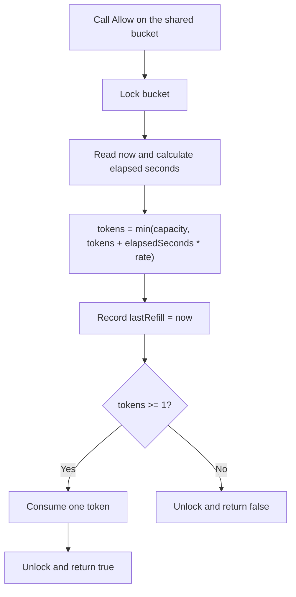
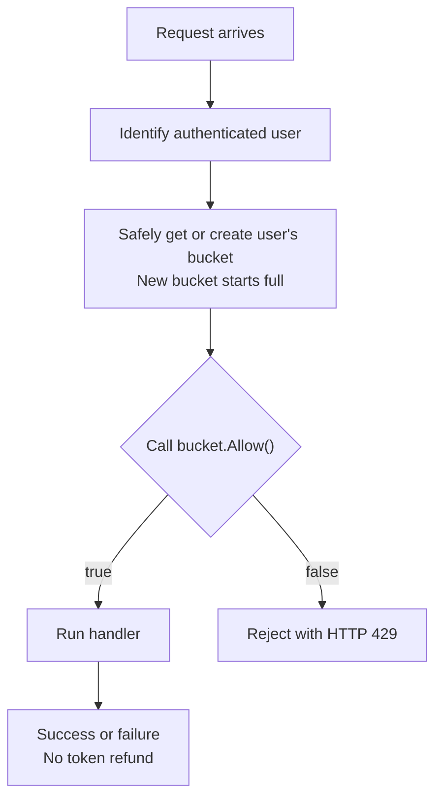

# Token Bucket: Theory and Go Implementation

[Back to the rate-limiter guide](../01-Rate-Limiter.md)

**Required depth for 3-4 YOE:** explain the policy, derive refill, implement synchronized admission, and test the guarantee.

## 1. The Problem It Solves

Real traffic is not evenly spaced. A user may send several requests together, then send nothing for a while.

We want to tolerate a limited burst without allowing that high rate to continue indefinitely.

Example requirement:

> "Each user may send an average of five requests per second, with a burst of ten. Reject requests when the user's allowance is exhausted."

Token bucket combines:

- **Sustained rate:** how quickly allowance is earned.
- **Burst capacity:** how much allowance can be saved.

It controls admission. It does not guarantee downstream health; concurrency limits and other protection may still be needed.

## 2. Where It Is Used

| Use case | Why token bucket fits |
|---|---|
| HTTP API admission | Allow occasional bursts while limiting sustained admitted traffic |
| Outbound API clients | Pace calls to a service whose contract allows bursts |
| Background job dispatch | Control job starts with a limited catch-up burst |
| Network traffic control | Charge bytes instead of requests |

HTTP admission often rejects excess work. Outbound clients often wait with a deadline instead. The refill model is the same; exhaustion behavior is a separate choice.

The Go package `golang.org/x/time/rate` implements this algorithm.

## 3. When It Is Not the Right Policy

| Required promise | More direct mechanism |
|---|---|
| Reset allowance every clock minute or at midnight | Calendar-aligned fixed-window quota |
| Never exceed N admissions in any rolling interval | Exact sliding-window log |
| Never run more than N operations simultaneously | Concurrency limiter/semaphore |
| Release queued work at a steady pace | Queue-based traffic shaper |

**Token bucket has no resetting time window.** Changing rate and capacity does not turn it into a strict rolling-window counter.

For example, capacity five and rate five/second can admit five requests immediately and another after 200 ms. That is six in less than one second.

## 4. A Capped Balance of Permission Tokens

Think of one token as permission to admit one request.

| Symbol/state | Meaning | Running example |
|---|---|---|
| Rate, r | Tokens earned per second | 5 tokens/second |
| Capacity, B | Maximum saved tokens | 10 tokens |
| Cost, c | Tokens spent per admission | 1 token |
| tokens | Current saved balance | Initially 10 |
| lastRefill | Time through which refill has been accounted for | Bucket creation time initially |

For the per-user example:

- Each authenticated user has one bucket.
- A new bucket starts full.
- Budget is local to one Go process.
- Tokens are charged on admission, before running the handler.
- Exhaustion means immediate rejection.
- An admitted request spends its token even if the handler later fails.
- A limiter-rejected request spends no request token.

Counting only successful business operations is a different requirement, usually needing separate quota/reservation accounting.

The current code implements **one shared bucket**, not a user registry or HTTP middleware. Per-user admission is a later extension.

## 5. Refill Formula, Explained Slowly

Calculate three things:

```text
earned tokens = elapsedSeconds * rate
updated balance = oldTokens + earned tokens
available tokens = min(capacity, updated balance)
```

Combined:

```text
tokens = min(capacity, tokens + elapsedSeconds * rate)
```

`min` takes the smaller value so the balance cannot exceed capacity.

### Leftover tokens

```text
Old balance = 3 tokens
Time passed = 1 second
Rate = 5 tokens/second
Capacity = 10

Earned = 1 * 5 = 5
Available = min(10, 3 + 5) = 8
```

Preserve the old three tokens and add five. Do not reset to ten. If a request is admitted now, the balance becomes seven.

### Long idle period

```text
Old balance = 3
Time passed = 10 seconds

Available = min(10, 3 + 10 * 5) = 10
```

The bucket becomes full because enough time elapsed, not because a reset boundary occurred. Excess allowance is discarded.

### Empty bucket

| Time | Event | Result |
|---|---|---|
| t=0 | Ten requests | All pass; bucket becomes empty |
| t=0 | Eleventh request | Rejected |
| t=100 ms | One request | Rejected; only 0.5 token available |
| t=200 ms | One request | Allowed; one token has accumulated |

These events form one timeline with no other consumption. At 200 ms, add another 0.5 token to the 0.5 retained at 100 ms.

An empty bucket earns tokens immediately as time passes, not at a window boundary. Keep fractional tokens; discarding them on every update can prevent frequent callers from accumulating a full token.

## 6. Lazy Refill: No Background Runner

Store the balance and its last accounting time. On each admission check:

1. Read the current time.
2. Calculate elapsed time since `lastRefill`.
3. Add earned allowance, capped at capacity.
4. Set `lastRefill = now`, even if rejecting.
5. Check and consume the request cost if available.

Updating the timestamp prevents crediting the same elapsed interval twice. Retain fractional balance and timestamp updates on rejection.

**Time-based refill is part of the standard algorithm. Periodic execution is not.**

- No ticker or refill goroutine per user.
- No refill work for idle buckets.
- O(1) accounting work and state per bucket.
- Use elapsed time, not the number of ticker notifications.

## 7. Algorithm Steps

Assume valid configuration and a non-decreasing local clock. Inside one synchronized operation:

```text
now = current time
elapsedSeconds = (now - lastRefill) in seconds
tokens = min(capacity, tokens + elapsedSeconds * rate)
lastRefill = now

if tokens >= cost:
    tokens -= cost
    allow
else:
    reject
```

Protect time accounting, refill, checking, and consumption with the same lock. Read time after acquiring the lock and unlock before running business logic.

## 8. Flow Diagrams

### Core algorithm: matches the current code



### Later extension: per-user HTTP admission

The registry must safely find or create one canonical bucket per user. Cleanup must not replace it while a caller still uses it.



Bucket creation needs registry synchronization in addition to bucket-state synchronization. This extension is not implemented yet.

## 9. Guarantee and Boundaries

A standard token bucket without future reservations bounds admitted cost over duration `T` by:

```text
B + r * T
```

This is a burst-plus-rate envelope, not an exact count per rolling second.

For positive rate and a cost that fits capacity, estimated retry delay is:

```text
max(0, (cost - tokens) / rate)
```

Other callers may consume tokens before retry, so this is not a reservation. A cost above capacity cannot fit, however long the caller waits. A zero refill rate does not replenish depleted tokens.

## 10. Current Go Implementation and Demo

- [tokenbucket.go](tokenbucket.go): model, initially full constructor, and mutex-protected `Allow()`.
- [main.go](main.go): four concurrent calls, printed results, and a `WaitGroup`.
- [Shared module](../go.mod): remains in the parent rate-limiter folder.

From the repository root, run:

```powershell
Set-Location '.\LLD-PROBLEMS\Rate_Limiter'
go run .\Token_Bucket
```

The demo uses capacity three and rate one token/second. If all four decisions occur before a whole token replenishes, three calls succeed and one fails. Request order is unpredictable.

**This is a smoke demonstration, not a deterministic unit test.** It does not prove refill or concurrency correctness under all schedules.

Current scope and limitations:

- One shared in-memory bucket; no identity registry, HTTP middleware, or cross-replica coordination.
- One token per admitted request; immediate rejection, no waiting.
- Positive finite configuration is assumed; validation was deliberately deferred during the exercise.
- Built-in `min` requires Go 1.21 or newer; the shared module specifies its Go version.
- Deterministic refill, burst, and concurrent-admission tests are still to be added.

The code is preserved as written during interview practice; this reorganization does not change the algorithm.

## 11. Interview Recap

**Memorize:**

```text
Lock -> Calculate elapsed time -> Refill and cap -> Update timestamp
     -> Check -> Consume if allowed -> Unlock -> Allow or reject
```

**Three rules:**

1. Time earns tokens.
2. Admission spends them.
3. Completion does not return tokens; returning permits on completion is concurrency limiting.

**Say this aloud:**

> "Token bucket controls sustained admission while allowing bounded bursts. I configure refill rate and capacity, then lazily calculate earned tokens whenever a request arrives. Under a lock, I refill up to capacity, update the timestamp, and consume the request's cost if available. Otherwise I reject. There is no resetting window, no required refill goroutine, and no automatic refund when the handler finishes."

## References

- [Go rate package](https://pkg.go.dev/golang.org/x/time/rate).
- [Go time package: monotonic clocks](https://pkg.go.dev/time#hdr-Monotonic_Clocks).
- [General interview preparation and testing expectations](../01-Rate-Limiter.md).
