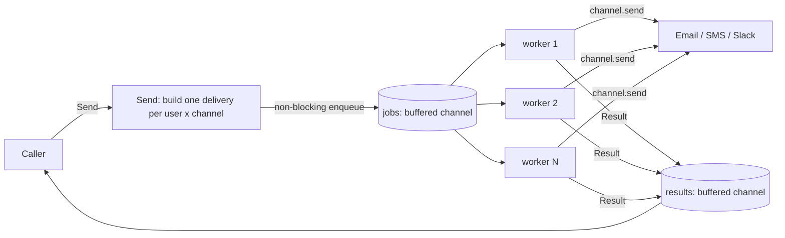

# Notification Service: Design and Interview Follow-ups

[Back to LLD topics](../LLD-Topics.md)

**Target:** 3-4 YOE Go developer. Goal: build a clean core in 30-40 minutes, then handle the follow-ups by explaining or sketching them.

---

## 1. The Problem

Build a service that sends a message to users over multiple channels (Email, SMS, Slack, Push). It must be easy to extend, must not block callers on slow providers, and must survive provider failures.

---

## 2. Requirements to Clarify First

Ask these before drawing anything. The answers set your scope.

| Question | Why it matters |
|---|---|
| Which channels, and will more be added? | Drives the `Channel` interface (Strategy, OCP). |
| One user or many per request? Which channels per request? | Fan-out shape: user × channel. |
| Must `Send` return immediately? | Decides sync vs async (worker pool). |
| Do we need to know if it was delivered? | Results, status tracking. |
| Failures: retry, fall back, or drop? | Retry and fallback follow-ups. |
| User preferences / opt-out? Critical messages (OTP)? | Preference filter, bypass rule. |
| Priorities? | Queue design. |
| Scale: in-memory or distributed? | Decides if Kafka/SQS/DB are in scope. |

### Scope split

| Level | Items |
|---|---|
| **Build (core)** | Models, `Channel` interface + implementations, service that fans out, async worker pool, bounded queue, graceful shutdown. |
| **Sketch if asked** | Retry with backoff, user preferences, priority, fallback channel. |
| **Just explain** | Idempotency, status tracking, circuit breaker, rate limiting, templates, scaling out. |

---

## 3. What We Built

### Entities (`model.go`)

| Type | Purpose |
|---|---|
| `Notification` | The request: `userIDs`, `messageType`, `priority`, `channels`, `subject`, `body`. Holds user **IDs**, not contact details. |
| `Recipient` | A user's contact details (`email`, `phone`, `slackHandle`). Each channel reads the field it needs. |
| `ChannelType` | Enum: SMS, Email, Slack. The key for the channel map. |
| `Priority`, `MessageType` | Enums, declared for priority and preferences (not used by the core yet). |
| `Result` | Outcome of one (user, channel) delivery. |

### The `Channel` interface (`channel.go`)

```go
type Channel interface {
    send(ctx context.Context, recipient Recipient, subject, body string) error
}
```

One method. `SMS`, `Email` and `Slack` implement it (Strategy). Adding WhatsApp means one new file and one `RegisterChannel` call. The service doesn't change (OCP).

### The service (`service.go`)



| Part | What it does |
|---|---|
| `NewNotificationService(workers, queueSize)` | Creates the maps and the bounded `jobs` channel. |
| `RegisterChannel`, `AddUser` | Fill the channel and user maps. Call them **before** `Start`. |
| `Start()` | Launches N workers. `wg.Add(1)` goes **before** each `go`. |
| `worker()` | `for d := range jobs`: skip if the delivery's `ctx` is cancelled, otherwise `channel.send`, then write a `Result`. |
| `Send(ctx, n)` | One `delivery` per user × channel, enqueued with a **non-blocking** `select`. Returns a buffered results channel. |
| `Stop()` | `sync.Once` closes `jobs`, then `wg.Wait()` so the workers drain the queue. |

### Files

```
model.go     entities and enums
channel.go   Channel interface
sms.go, email.go, slack.go   implementations (fakes that print)
service.go   pool, queue, Send, Stop
main.go      demo
```

---

## 4. Key Decisions and Why

| Decision | Reason |
|---|---|
| **The unit of work is one delivery** (user × channel), not a whole notification. | A failed SMS can be retried alone. One slow channel doesn't hold up the others. |
| **Worker pool, not a semaphore.** | The service is long-lived with a queue. We need backpressure, priority, retry and drain-on-shutdown, all of which need a queue we control. A semaphore fits a one-shot "run this batch and wait" job. See [Worker Pool](../DESIGN-PATTERNS/10-Worker-Pool.md). |
| **One pool owned by the service**, created once in `main` and passed around. | One bounded set of workers however many callers there are. No singleton: a global makes tests share state. |
| **Bounded queue with a non-blocking enqueue.** | `Send` never blocks the caller. A full queue becomes an explicit `ErrQueueFull` result (backpressure), not unbounded memory. |
| **`ctx` stored in each `delivery`.** | The job runs after `Send` returns, so the request's context has to travel with it. Cancelling a request skips its queued deliveries. |
| **Results channel is buffered to the call's size.** | Workers never block on it, even if the caller ignores it. No leaked goroutines. |
| **Close the queue, then wait.** | Closing makes each worker's `range` end after the buffer is drained, so queued work isn't lost. |
| **Interfaces for `Channel`.** | Tests use fakes. No real network. |

---

## 5. Concurrency Points Interviewers Dig Into

**`wg.Add` before `go`.** If `Add` ran inside the goroutine, `Stop` could call `wg.Wait()` before the goroutine was scheduled and return early.

**Who closes what.** The service closes `jobs` (the only sender side that knows when it's done). Workers never close anything. Closing from many writers panics.

**Order in `Stop`.** Close first, then `Wait`. `Wait` before `close` deadlocks, since the workers never exit.

**Send after Stop panics** (a send on a closed channel). A guard is a `stopped` flag under an `RWMutex`: `Send` takes `RLock` and returns an error if stopped, and `Stop` takes the write lock to set the flag and close.

**Shared maps.** Workers and `Send` read `users` and `channels` concurrently. That's safe only because they're written before `Start`. If they must change at runtime, guard them with an `RWMutex`, or use an immutable snapshot.

**Backpressure options.** Block, reject (what we do), or drop the lowest priority. Say which fits which message: reject or block for an OTP, drop for marketing.

---

## 6. Follow-ups (the part that gets scored)

### 6.1 Retry with backoff (most likely follow-up)

Retry **one delivery**, not the whole request, with exponential backoff and jitter:

```
delay = min(base * 2^attempt, max) + random jitter
```

Two ways to place it:

| Approach | How | Trade-off |
|---|---|---|
| **Decorator** around a `Channel` | `RetryChannel{inner, maxAttempts, base}` implements `Channel` and loops. | Tiny and composable (see [Decorator](../DESIGN-PATTERNS/05-Decorator.md)). But it **holds a worker** while sleeping. |
| **Re-enqueue** the delivery with a `notBefore` time | A worker puts it back after a delay (or a timer does). | Doesn't block workers, but needs an attempt counter and a delay mechanism. |

Rules to state:
- **Retry only transient errors** (timeout, 5xx, rate limited). Never invalid phone number or bad request.
- **Cap attempts**, then give up (dead-letter or report failure).
- **Jitter** so many failures don't all retry at the same moment (retry storm).
- **Respect `ctx`**: stop sleeping when it's cancelled.
- Retries go **through** a circuit breaker, so an open breaker stops the storm.
- Retrying a send that may have succeeded creates **duplicates**, so retry needs idempotency (6.5).

### 6.2 Priority

Our queue is one FIFO, so an OTP can sit behind 10,000 marketing messages.

| Option | Notes |
|---|---|
| **A queue per priority**, workers check High first, then Medium, then Low (nested `select` with `default`). | Simple. Low can **starve** if High never empties. |
| **Weighted workers** (e.g. 3 workers for High, 1 for Low). | Guarantees some Low throughput. |
| **Priority heap** with a mutex and `sync.Cond`. | Fine-grained and supports aging, but more code. |
| **Aging** | Raise a message's priority the longer it waits, to prevent starvation. |

Also: **bypass the shared queue** for critical types, or reserve capacity for them, so a marketing flood can't fill the queue and reject an OTP.

### 6.3 User preferences

A **filter step in `Send`**, before enqueueing, which removes (user, channel) pairs the user opted out of. Shape it as a Chain of Responsibility ([notes](../DESIGN-PATTERNS/06-Chain-of-Responsibility.md)): preference check, then dedup, then rate limit, then enqueue.

- Preferences are per **channel** and per **message type**: `map[userID]{channels, types}`.
- **Critical types (OTP, security alerts) bypass opt-out.**
- **Quiet hours:** hold non-critical messages until the window ends, or drop them.
- Filtering before the queue means opted-out sends never use a worker.

### 6.4 Fallback channel

If Push fails after its retries, try SMS. Keep an **ordered channel list per message type** (OTP: SMS, then Email). On final failure of one, enqueue the next as a new delivery. Cap the chain so it can't loop. Say what counts as "failed" (retries exhausted, not a single error).

### 6.5 Idempotency and delivery guarantees

- A client retrying `Send`, or a worker retrying after a timeout, can **duplicate** a message. For an OTP that's bad.
- Use an **idempotency key** (client-supplied, or `notificationID + userID + channel`). Keep a `seen` set with a **TTL**, and drop a delivery whose key has been seen.
- **Check-then-send is a race**: use an atomic `SetIfAbsent`.
- Where to record "seen": before sending gives **at-most-once** (a crash loses the message), after sending gives **at-least-once** (a crash can duplicate). Pick one per message type: at-least-once with idempotency for OTP and transactional, at-most-once for marketing.
- Our in-memory queue is lost on a crash, so it's effectively at-most-once.

### 6.6 Status tracking

Track `Pending → Queued → Sent → Delivered / Failed` per **(notification ID, user, channel)**, in a store you can query. Needs an ID on `Notification`. This is the [State pattern](../DESIGN-PATTERNS/07-State.md) with a status store. Our `Result` is the in-memory stand-in. Note that "sent" (the provider accepted it) differs from "delivered" (a delivery receipt or webhook arrived later).

### 6.7 Circuit breaker and rate limiting

- **Circuit breaker per provider**, so a dead SMS provider fails fast and doesn't tie up workers. Wrap the channel with it. See [Circuit Breaker](../Circuit_breaker/01-Circuit-Breaker.md).
- **Per-user rate limit** (anti-spam) and **per-provider rate limit** (respect quotas). See [Rate Limiter](../Rate_Limiter/01-Rate-Limiter.md).
- **Isolation (bulkhead):** a separate pool or queue per channel, so a slow SMS provider can't starve Email.

### 6.8 Templates

Keep it out of the core: `Notification` has a plain `subject` and `body`. To add templates, introduce a template with a body per channel (SMS short, Email rich) and variables rendered with `text/template`. Render in the service before enqueueing, or in the worker. Questions to expect: what if a channel variant is missing (error, skip, default), and what if a variable is missing. Put it behind a small `Renderer` interface.

### 6.9 Scaling beyond one process

| Concern | Answer |
|---|---|
| Queue is lost on crash | A durable queue: Kafka, SQS or RabbitMQ. |
| Write to DB and enqueue atomically | **Outbox pattern**: write the notification and the outbox row in one transaction, and a relay publishes it. |
| Poison messages | **Dead-letter queue** after N attempts. |
| Different load per channel | A topic or queue **per channel and priority**, with separate worker fleets. |
| Rate limits across replicas | Shared state (Redis) or a per-replica share of the quota. |
| Duplicate delivery | Idempotent consumers (6.5). |

### 6.10 Is this just Pub/Sub?

Partly. The fan-out from one request to many channels is like [pub/sub](../Pub_Sub/01-Pub-Sub-System.md), and [Observer](../DESIGN-PATTERNS/04-Observer.md) is the same idea. But a notification is **addressed to a specific user** (not broadcast to whoever subscribed), and the service adds retries, idempotency, preferences and tracking that a basic broker doesn't. You can use pub/sub **inside** the service (per-channel topics) or **in front of** it (other systems publish events like `order_placed`, and the service decides who to notify).

---

## 7. Interview Q&A

**Q: Why a worker pool and not a goroutine per message?**
Unbounded goroutines mean unbounded memory and unbounded load on providers. A pool bounds both, and the queue gives backpressure.

**Q: Why a worker pool and not a semaphore?**
A semaphore bounds concurrent work but not waiting goroutines, and has no queue to reorder, inspect or drain. We need priority, retry and graceful shutdown.

**Q: How many workers?**
The work is I/O-bound (waiting on providers), so it's not `GOMAXPROCS`. Tie it to provider limits and latency, and make it configurable.

**Q: What happens when the queue is full?**
`Send` returns an `ErrQueueFull` result for that delivery. The caller can retry later. Alternatives are block or drop-low-priority.

**Q: How do you add a new channel?**
Implement `Channel`, call `RegisterChannel`. No change to the service.

**Q: How does shutdown work?**
Stop accepting sends, close `jobs`, workers drain the buffer and exit, `wg.Wait()` returns. A shutdown deadline would use a context that cancels in-flight sends.

**Q: Why does `Send` take IDs instead of recipients?**
Callers shouldn't need to know phone numbers or emails. The service resolves them through a user store, which in production is a DB or service call behind an interface.

**Q: How do you test it?**
Fake channels (count calls, sleep, or fail on demand), `go test -race`, and an injectable clock for backoff. Test that `Send` returns quickly, that `Stop` drains everything, and that a full queue returns `ErrQueueFull`.

**Q: Limitations of what you built?** (say these before they ask)
- No retry, priority, preferences, fallback or idempotency.
- The queue is in memory, so it's lost on a crash.
- No validation: an unregistered channel is a nil dereference in the worker, and an unknown user is an empty recipient.
- `Send` after `Stop` panics.
- The results channel isn't closed, so the caller must know how many to read.
- Maps are written only before `Start`.

---

## 8. Whiteboard Script (2 minutes)

> "A notification is a request to send one message to several users over several channels. I model a `Channel` interface with one method, `send`, and implement Email, SMS and Slack. That's Strategy, and adding a channel doesn't touch the service.
>
> The service takes user IDs, resolves them to recipients, and turns the request into one delivery per user and channel. Those go on a bounded queue, and a fixed pool of workers, created once, sends them. `Send` never blocks: it does a non-blocking enqueue and returns a results channel, and a full queue shows up as an explicit error result. Each delivery carries the request's context.
>
> Shutdown closes the queue and waits for the workers to drain it. For reliability I'd add retries with exponential backoff and jitter on transient errors only, a circuit breaker per provider, and idempotency keys so a retry can't send an OTP twice. Priority means separate queues so an OTP never waits behind marketing, and preferences are a filter before the queue. To scale out, the queue becomes Kafka or SQS with an outbox and a dead-letter queue."

---

## 9. Checklist

- [ ] Can I explain why the unit of work is one delivery?
- [ ] Can I explain worker pool vs semaphore for this problem?
- [ ] Can I explain `wg.Add` before `go`, and close-then-wait in `Stop`?
- [ ] Can I explain who closes the results channel, and why the workers don't?
- [ ] Can I describe backpressure and the options when the queue is full?
- [ ] Can I write a retry wrapper with exponential backoff and jitter?
- [ ] Can I explain which errors to retry and which not to?
- [ ] Can I design priority queues and explain starvation?
- [ ] Can I explain idempotency and at-least-once vs at-most-once?
- [ ] Can I place the circuit breaker, rate limiter and retry relative to each other?
- [ ] Can I say what my implementation does **not** do?
